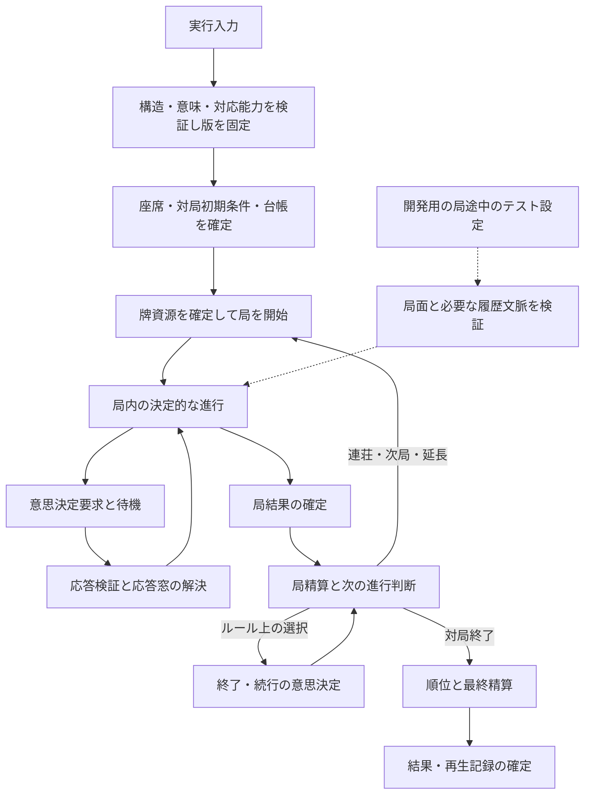

# 再設計案

区分と G-ID は[レビューの入口](README.md)、Q-ID は[未解決の判断](questions.md)、H-ID は[履歴調査](history.md)を参照する。図・状態・責務・入出力は概念モデルであり、回答で合意した事項を除き Rust の型、trait、API、schema を確定しない。

## 1. Project goals and non-goals

### Confirmed requirement

主目的は AI / reinforcement learning 用途の日本式リーチ麻雀 simulation（G-01）。決定性・再現性（G-02）、スループット・並列性（G-03）、非同期 agent（G-04）、複数 ruleset と mechanics の分離（G-05）、再生・テスト容易性（G-06）を重視する。今回は設計レビュー資料を作り、実装を開始しない（G-07〜G-10）。

仕様化の第1問への回答により、最初の公開 API の利用シナリオは「複数卓の対局実行」とする。複数の対局を進め、非同期に agent の判断を受け取り、それぞれの対局結果を得る。第2問への最終回答により、呼び出し側は Agent trait の実装を渡し、LizhiSim が呼び出す。呼び出し側の手間を減らし、LizhiSim が複数卓の互換な意思決定要求を集約して Agent に渡し、Agent trait がバッチ推論・通信と非同期回答を担う。第3問への回答により、LizhiSim が指定した対局群を進め、完了後に結果を返す。公開 API は第37問で同期型に確定した。内部実行管理、trait の method signature、公式ルールプリセットの初期範囲は第98問で雀魂の四人段位戦・東風戦と半荘戦に確定（[回答の記録](questions.md)）。

第97問（2026-11-20）で、最初は Rust API を提供することが確定した。Python API は将来の検討対象に残すが、最初の公開契約・受入シナリオ・完成条件には含めない。Python 向けの具体的な接続・型変換・非同期表現・配布方法と対応時期は未決とし、trait・crate・依存を先行確定しない。Agent 内部の実装・通信手段の自由度は維持する。今回は Rust API の契約案を具体化する段階であり、Rust 実装の開始指示とは扱わない。

第98問（2026-11-20）で、最初に完成を目指す公式ルールプリセットは雀魂の四人麻雀段位戦の一ルールとし、東風戦・半荘戦の両方を含めることが確定した。他の指定済み四人・三人ルールのプリセットは順次追加する対象とし、差分調査と複数ルールを表現できる設計の検討、個別設定の組合せは維持する。適用版・段位戦内の差分や個々の細則・値は公式根拠で確認し、選定だけで検証済みと扱わない。ルール以外の合意済み機能を延期・削除する決定ではなく、実装開始の指示とも扱わない。

第116問（2026-11-20）で、Rust API 案の命名は中国語ピンイン中心とすることが確定した。説明は日本語を基本とし、具体的な型・メソッド名と個別の対応語はレビューする。旧用語集は必要になった段階で main ブランチから回収して参照し、現段階で調査・復元・再作成は行わない。旧資料の個別名称は今回の回答だけで自動的に採用済みとはしない。

2026-11-19 のスコープ判断により、Epsilon 型の局面分岐（同じ進行中の局面を複製し、行動候補ごとの別経路を実行・比較する機能）は当面の設計・実装対象に含めない。将来の採用可否は未決とし、分岐専用の Agent 契約・実行管理・牌譜形式は先行設計しない。通常の対局結果として牌譜を残す意向や replay の要件、外部指定局面の採否（Q-12）とは別の判断である。

第31問（2026-11-19）で、一回の対局群の実行は一つのルールに統一することが確定した。異なる人数・ruleset の混在は最初の公開契約に含めない。一戦完結形式だけを扱う決定ではなく、複数戦合計・リーグ・トーナメントの対応範囲は未決である。大会全体の集計・組合せ・進出判定と、個々の対局に影響する開始・終了条件や大会文脈を分けて検討する。

第32問（2026-11-19）で、まず対局実行を仕様化し、大会全体の進行・集計は呼び出し側で組み立てることが確定した。複数戦合計・シーズン順位・組合せ・進出判定等の大会管理機能は最初の対象に含めず、将来の追加可否・配置は未決とする。大会形式に必要な個々の対局条件・Agent の観測情報は検討対象に残す。持越し点等による対局の開始・終了条件への影響を単なる外側の集計で済ませず、具体的な受渡し契約は今後決める。

第32問への補足（2026-11-19）で、大会全体の進行・集計は現段階では非対応とする方針を再確認した。外部の大会進行処理を今回提供することも確定していない。単純な X 戦連続形式を将来の設計候補に残すが、現段階の実装・完成条件には含めない。

第33問（2026-11-19）で、通常の開始点に加え、参加者ごとの開始持点を対局ごとに指定できるようにすることが確定した。最初の局を配る前を対象とし、指定可能な条件や点数の妥当性は採用ルールに従って検証する。大会通算成績を卓上の持点へ自動変換しない。開始持点の入力表現、未指定時の解決、検証条件、終了判定・最終精算との関係は未決であり、途中局面からの開始や大会文脈の Agent への受渡しは別に検討する。

第34問（2026-11-19）で、LizhiSim は規則上の結果を提供し、学習用の報酬計算は利用側が担当することが確定した。持点・最終精算ポイント・順位等の競技上の結果と、reward・正規化・割引・reward shaping 等を区別する。将来の連戦の集計・進出判定も競技上の結果であり、それを報酬としてどう使うかは利用側が決める。

第35問（2026-11-19）で、参加者の初期の席への割当は、呼び出し側の明示指定と seed によるランダム割当の両方を提供することが確定した。参加者と Agent インスタンスは区別し、共有 Agent を使う場合も割当を識別できるようにする。対局中の親の移動等のルールや、大会全体の対戦カード生成は別の判断である。指定方法・既定値、検証条件、ランダム割当方式、seed の指定・導出方法、replay に残す割当の具体表現は未決とする。

第36問（2026-11-19）で、公開の対局実行 API は対局の最初からの開始に限定し、局途中の状態指定は単体・リグレッションテスト用の支援として必要とすることが確定した。合意済みの開始持点・初期席順は公開 API で扱う。テスト支援は対象局面・必要な履歴文脈を設定して通常の進行を検証するためのものであり、独立したテスト専用の遷移ロジックを作る決定ではない。任意局面の production 公開 API や局面分岐は含めない。テスト支援の配置・可視性・入力形式・検証範囲は未決とする。

第66問（2026-11-19）で、全対局の開始条件を実行前に検証し、不正があれば対局群全体を開始しないことが確定した。初期席順・開始持点等と実行全体の共通設定が対象であり、Agent 内部や将来の応答の正しさを事前保証するものではない。実行中の不正行動等の扱いは維持する。具体的な検証項目・診断、複数不備の報告、外部資源の準備との順序は未決とする。

第61問（2026-11-19）で、正常系の公開 API 利用例・受入例は四人麻雀から具体化することが確定した。仕様化の順番であり、三人を含むルール比較対象は維持する。基準 ruleset は第62問で雀魂の四人段位戦に確定した。対局形式は第63問、公式ルールプリセットの初期範囲は第98問で確定。適用版・細則とその他の完成条件は未決とし、未確認のルール差分の調査も継続する。Rust 実装は開始しない。

第62問（2026-11-19）で、その最初の基準 ruleset は雀魂の四人麻雀段位戦とすることが確定した。適用版・細則は公式資料で照合し、選定だけで個々のルール値を検証済みとは扱わない。対局形式は第63問で東風戦・半荘戦の両方に確定した。公式ルールプリセットの初期範囲は第98問で確定。段位戦内に差分がある場合の対象範囲と、その他の完成条件は未決とする。他の指定ルールとの構造的な差分の調査は維持する。

第63問（2026-11-19）で、基準とする雀魂の四人麻雀段位戦は東風戦・半荘戦の両方を同じ段階で仕様化し、利用例・受入例に含めることが確定した。各形式の連荘・延長・終了条件等は公式資料で照合する。一回の実行は一つのルールに統一する第31問は維持する。公式ルールプリセットの初期範囲は第98問で確定。適用版・細則、段位戦内の差分の対象範囲と、その他の初期 release の完成条件は未決とする。

第64問（2026-11-19）で、最初は対局の最終持点・順位等を提供し、段位ポイントへの換算は利用側に任せることが確定した。昇段・降段の処理は不要とする。固定の順位別換算表による平均ポイントは順位別回数と総数から求められるが、持点・段位・卓等に依存する換算には対応する入力・集計も必要である。第65問で、最初は各順位の回数を計算する統計補助機能を提供することが確定した。外部実装の参考調査は[回答記録](questions.md)を参照し、その評価・学習用の値を現行サービス全条件の公式計算と同一視しない。学習報酬を利用側が決める第34問は維持する。

第65問（2026-11-19）で、対局結果から基本統計を計算する補助機能を提供し、最初は各順位の回数だけを出すことが確定した。段位ポイント換算・学習報酬は含めず、平均順位・平均持点等の追加内容は後で決める。比較セットの採否は第77問で全配置の最終順位が確定したセットだけに確定した。グループごとの数え方は第78問で全参加席の結果の合算に確定。具体 API・結果表現と出力・通知失敗の記録との対応は未決とする。中断・未開始の対局に最終順位を捏造しない。

第77問（2026-11-19）で、順位別回数の統計は全配置の最終順位が確定した比較セットだけを対象にすることが確定した。一部配置が中断したセットは終了した配置の分も含めて統計から除外し、各対局の結果・牌譜は残して除外を識別できるようにする。統計の選別によって他配置の進行方針や終了済み結果を変更しない。最終順位の確定と通知・出力の成否は区別する。グループごとの数え方は第78問で確定。実行全体中断時の集計範囲は第79問で確定。集計・除外情報の具体表現は未決である。

第78問（2026-11-19）で、順位別回数は比較グループごとに全参加席の結果を合算することが確定した。Agent インスタンスの同一性ではなく、各参加席が属する比較グループで分類する。完全な比較セット一つにつき、1vs3 は4件・12件、2vs2 は各12件、各1席の4グループは各24件となり、一つの参加席の最終順位を一件として数える。セットごとの平均・正規化は行わない。第65問の順位別回数のみの初期範囲と、第77問の完全な比較セットだけを対象とする方針は維持する。実行全体中断時の集計範囲は第79問で確定。グループと Agent の対応は第93問で一グループに一インスタンスと確定。具体的な結果・指定の表現は未決である。

第79問（2026-11-19）で、停止要求や出力エラー等による実行全体の中断時も、全配置の最終順位が確定した比較セットの順位別回数を返すことが確定した。実行全体の中断・エラーも併せて示す。100セット中30セットの全配置の順位が確定していれば、その30セットを集計する。不完全なセットは第77問どおり終了済み配置も含めて除外し、各対局の結果・牌譜を残す。集計は第78問どおり比較グループの全参加席を合算する。順位の確定と通知・出力の成否は区別し、出力失敗だけを理由に確定済み順位を集計対象から外さない。故障した出力先への記録成功やプロセス強制終了からの復旧は保証しない。具体的な返却形式・採否情報の表現は未決である。

第37問（2026-11-19）で、公開の対局群実行 API は同期型とすることが確定した。呼び出したスレッドは対局群・必要な終了通知・牌譜出力の処理完了まで待つ。内部では複数卓を並列に進め、Agent の非同期応答と受付範囲内の複数バッチ処理を扱う。公開 API の同期性から、学習器との逐次実行や実行中の方策固定を要求するものではない。第38問で方策更新と学習用の方策情報等の管理は Agent 側の責務とした。学習用の途中経験の受渡しの具体契約は未決とし、特定の学習方式は採用しない。method signature と内部 worker・runtime、Agent・出力先の非同期表現は未決である。

第44問（2026-11-19）で、呼び出し側から実行中の対局群へ停止を要求できるようにすることが確定した。公開 API は同期型を維持し、別スレッド等から要求を届ける具体的な制御手段は今後決める。第45問で新規対局を開始せず進行中対局も中断することが確定した。Agent 呼び出し・通知・牌譜出力の終了、結果表現と停止完了までの期限は未決である。非同期の公開 API でも、進行と外部処理の終了契約は必要である。

第45問（2026-11-19）で、停止要求を受けたら新しい対局を開始せず、進行中の対局も中断して終了処理へ進むことが確定した。途中牌譜と中断通知を扱い、完了済み結果・中断・未開始を区別して返す。通常の対局終了まで打ち続ける方式にはせず、外部処理の強制停止や瞬時の復帰は保証しない。処理中要求・バッチの取消と遅延応答、状態更新と中断の境界、終了処理の期限、利用者停止の結果表現は未決とする。

第38問（2026-11-19）で、実行中の方策更新を認め、内部の更新タイミング・整合性は Agent が管理することが確定した。LizhiSim は trait 経由の要求・応答・受付・通知等の外部契約を定め、Agent 内部のモデル構成・推論方法・学習・方策の切替には関与しない。処理中バッチとの内部整合性や学習用の方策版等の管理も Agent 側の責務とする。方策を固定する Agent も扱える。合法手・情報公開・受付範囲・処理順・応答期限等の外部契約は維持し、モデル更新機構や特定の学習方式は内製しない。

### Candidate design

| 目的 | レビューする契約・評価方法 |
|---|---|
| 正しい simulation | 一局の進行、対局の進行、点数精算を、それぞれルール根拠・境界ケースから検証できる |
| 決定性 | 同じ意味版・ルール・初期条件・具体化済み乱数入力・要求ごとの確定応答なら、同じ意味イベントと結果を得る |
| 非同期・並列性 | 一卓の待機が独立卓を止めず、worker 数・応答の配送順・batch 分割が麻雀上の優先順位を変えない |
| 高スループット | 固定 workload で局数/秒、意思決定数/秒、卓あたりメモリ、待機・再開 latency、記録コストを測る |
| 複数ルール | 数値差だけでなく合法手・競合解決・遷移順序・終局・精算の差を、明示した意味単位で表す |
| 再生・テスト | GPU・network なしで遷移を検証し、再生不一致を最初の原因入力・判断点まで追跡する |
| RL への接続 | agent の観測・選択・結果を外部の学習器へ渡せる。報酬や学習 framework の都合でゲーム規則を変えない |

将来の candidate design として、X 戦連続の対局から最終ポイント・通算順位・進出者等を求める形式を検討する。対戦カードの生成・更新、席順、集計・同点処理・進出条件、開始持点との関係は未決であり、現在の公開 API の完成条件にしない。シーズン等も考慮した大会規則の拡張ポイントは候補に留める。対局結果から次の対戦カード・開始条件を求める大会進行と、現在の対局の終了等に作用する競技条件を分け、具体的な大会シナリオから必要な入出力・反映時点・replay 入力を検討する。拡張機構の採否・境界・配置は未決であり、具体的な trait・callback・汎用大会 framework は確定しない。

第4問で[四人/三人の比較対象](rule-differences.md)が確定した。最初の実装対象を一つ選ぶ前に、実ルールの構造差から公開 API の必要情報・意思決定・終端境界を確認する。比較対象への採用と、全対象を初期 release で完成させることは区別する。

非目標の候補は、学習アルゴリズム自体、人間向け GUI、公開対戦サービス、認証・アカウント管理、実卓の所作や審判運用の完全再現、公式サービスの牌譜取得機能である。これらは今回の作業に含まれず、製品として恒久的に対象外にするかは Q-01 で確認する。

第5問で、通常の simulation は合法行為のみとすることが確定した。実卓の反則とそれに伴うアガリ放棄・罰点・局のやり直し等の再現は対象外として条項を追跡する。Agent の不正応答は API エラーであり、麻雀の反則へ変換しない。合法な見送りや申告の選択は別に扱う。第12問により、提示された合法手以外の行動への対応は該当対局の中断と他卓の続行に確定した。その他の API エラーへの対応は Q-09 で未決。

旧方針の Gym 非対応、同期的な単卓公開 `step()` の禁止、四人・三人の両対応、サービス別プリセット順序、大会・段位への対応は履歴上の要件として残す。非同期性は必須の目的だが、それだけで特定の公開 API の禁止や大会全体の内製が導かれるわけではない（H-03、H-12、Q-01、Q-02）。

### Unresolved question

初期対象の人数・ルール family・対局形式・製品非目標は Q-01、公開実行方式は Q-02、性能目標と保証する環境は Q-10。根拠のない性能数値、対応済みプリセット、release 条件を置かない。

## 2. Domain model

### Confirmed requirement

日本式リーチ麻雀を複数 ruleset で扱い（G-01、G-05）、非同期な意思決定と再生を支える（G-02、G-04、G-06）。既存の型や crate を概念モデルの出発点にしない（G-07）。

### Candidate design

| 概念 | 所有する意味・責務 | 境界 |
|---|---|---|
| 実行・試行 | ルール意味版、初期条件、agent 方策版、乱数入力、終了・中断の記録 | 学習目的・分布・実験予算はゲーム規則と別に扱う |
| 参加者・座席・親 | 参加者は agent との対応、座席は卓内位置、親はその局の役割 | 配牌順、固定座席順、親からの相対順を同一視しない |
| 対局 | 得点台帳、供託、本場、場・局位置、親、初期条件、終了判断 | 一局の終了を受けて次局・連荘・対局終了を決める |
| 局 | 牌の所在、手番、宣言、応答窓、資格と履歴、終端事実 | ルールが認めた行為と内部遷移だけで進む |
| 座席ごとの局内状態 | 手牌、副露、河、抜き牌、立直・フリテン・一発・第一巡等の文脈 | 点数の正本を重複保持せず、必要な台帳情報を読めるようにする |
| 牌資源 | 使用牌の multiset、取得順、通常山・補充領域・表示牌の位置と利用状況 | 位置・取得可能性・公開許可を分ける |
| 意思決定点 | 原因、対象座席、可視情報、合法な選択肢、状態の世代 | agent の応答先を一意にし、古い応答を別局面へ適用しない |
| 応答窓 | 一つの原因に対する複数座席の意思、受付状況、解決規則 | 受付と解決を分け、到着順で麻雀結果を決めない |
| 局結果 | 終局理由、和了者・対象牌・資格・評価文脈、流局時の事実 | 精算に十分な事実を保持する。終局理由だけに縮めない |
| 精算 | 理由付き点数移動、供託の扱い、次局条件、最終順位・対局精算 | 手牌の和了評価、支払計算、対局最終精算を分ける |
| ルール意味論 | 合法性、優先、遷移の順序、終局、連荘、対局終了、支払い | 入力ファイル、サービス名、出典管理、実行 runtime と分離する |

比較対局についての candidate design（2026-11-19）: Agent の実行インスタンスと比較グループを区別し、人数配分と同じ牌山を共有する比較セットから、各席配置の独立対局を生成するモデルを検討する。四人で区別可能な4グループを各1席に置く場合は24通り、1vs3は4通り、2vs2は6通りとなる。グループ内の入替えを別ケースとして増やすモデルにはしない。Agent を複数回登録するだけのモデルや、統計ラベルだけの選択に先に固定しない。展開主体は第74問で LizhiSim に確定した。統計の数え方は第78問で比較グループの全参加席の合算に確定。具体的な対応範囲・グループ識別は未決である。対局中の局面分岐や大会進行の管理とは区別する。

第74問（2026-11-19）で、比較グループ・人数配分・セット数を指定し、LizhiSim が席配置を重複なく展開して同じ牌山を共有する比較セットを実行することが確定した。各配置の対局は独立に進行し、結果にセット・配置・グループとの対応を残す。Agent の登録回数ではなく比較グループの配分で配置を区別する。複数局の対応は第75問で場を含む局番号＋本場に確定した。結果一覧は第88問で対局番号順に確定。具体的な入力・識別形式、展開順、初期席順との整合、部分失敗・統計の具体的な表現は未決である。グループと Agent の対応は第93問で一グループに一インスタンスと確定。

牌には「和了形の判定における同等性」と「赤牌を区別する行為・得点上の同一性」がある。河の鳴かれた牌を履歴に残しても、副露との二重所有にしない。表示牌は山にある牌への参照であり、公開のために牌が増えるものではない。

第93問（2026-11-20）で、比較セットの指定では一つの比較グループに一つの Agent インスタンスを対応させることが確定した。1vs3の基準側3席も同じ Agent に要求を渡し、対局・座席ごとの状態と外部プロセスの管理は Agent 内部で扱う。一グループ内の複数インスタンスへの割当を LizhiSim が管理する方式は最初の契約に含めない。グループとインスタンスの概念上の区別、配置の展開・グループ単位の集計、同じ Agent の入口の直列化と受付範囲内の非同期処理は維持する。具体的な指定形式・コンテキスト識別の表現は未決である。

牌の内部表現は、赤を分ける37種の個数、基礎牌種と属性の組、個体識別を持つ方式を比較する。赤の区別や取得由来による手切・摸切の意味は守り、配列長や個体 ID の要否は確定しない。外部牌譜固有 ID は trace に閉じる案が情報漏洩と source 結合を避けやすい（H-05、H-08）。

立直可能性は得点・供託にも依存するため、「局は終局まで対局台帳に関与しない」とはしない。候補 A は対局と局を一つの更新単位にし、候補 B は局中の徴収・返却を台帳へ明示的に反映する。B は重複適用防止と局側の参照時点の契約が増える（Q-06）。

局面の牌姿だけでは、フリテン、第一巡、一発、責任払い等は復元できない。将来の判定に必要な履歴要約を状態に含める。個々の資格を一つの共通 flag で代用できるとは仮定しない（H-09）。

### Unresolved question

牌の表現・取得由来は Q-03、状態の所有と型による保証は Q-02、得点台帳の原子的更新は Q-06、外部指定局面の履歴保証は Q-12。名前の選択と意味上必要な情報を切り分ける。

## 3. Game lifecycle

### Confirmed requirement

非同期応答・並列実行・再生を扱う（G-02〜G-06）。以下の lifecycle は目的を満たす候補であり、既存 API の延長ではない。

### Candidate design

ルール上の状態と実行基盤の状態を直交させる。応答待ち、queue の backpressure、出力待ち、失敗、取消は、槓・流局等のゲーム phase ではない。実験予算による打切りを対局の正常終了として記録しない。

応答待ち中も他卓を進める。対局ごとの局所的なイベント順は必要だが、独立卓すべての強制的な全順序は設けない候補とする。卓間依存が生じる大会集計や対戦相手更新は別の入力境界となる（Q-01、Q-08）。

同一卓の状態更新には一つの論理的な所有者を置き、同じ窓を複数 worker が同時に確定しない案とする。卓間は独立に分配し、LizhiSim は意思決定要求を Agent へ供給する。2026-11-19 の明確化により、互換な要求の集約は LizhiSim が担い、Agent はバッチ推論・通信を行って非同期に回答する。LizhiSim は回答がそろった卓を再開し、一卓の応答待ちが独立卓の進行を止めない。受付条件、バッチ上限、送信条件、具体的な要求の受渡し単位、queue 上限と backpressure の境界は Q-02・Q-07・Q-10 で具体化する。混雑を理由にルール上の見送り・流局を暗黙に発生させない案とする。

対局の進行判断は、局の支払い、供託、本場、親の継続資格、飛び、規定局、目標点、延長、終了選択の順序をルールごとに明記する。「予定局数を消化したら終了」という共通処理にはしない。成立した終了条件同士の優先も ruleset の意味に含める（Q-05、Q-06）。

外部指定局面は旧資料に追加要求として記録されていた（H-12）。第36問により、局途中の状態指定は開発用のテスト支援とし、現在の production 公開 API には含めない。テスト局面は必要な状態・履歴文脈を設定し、配牌や立直徴収を二重適用せず、対象 phase から通常と同じ進行を検証する。具体的な入力・検証範囲は Q-12 で決める。

### Unresolved question

対局・大会の製品範囲は Q-01、時間制限・管理打切りは Q-09、外部局面の受入範囲は Q-12。初期プリセット未選定のため、終局条件の公式値はまだ置かない。

## 4. State transitions

### Confirmed requirement

ルール差が state transitions に影響する位置を示す（G-05、G-10）。具体的な Rust 表現は未確定（G-08）。

### Candidate design

純粋な状態計算と外部効果の分離を候補とする。下表は意味上の phase であり、一行一型を要求しない。「入力を検証」「ルール判断」「状態とイベントの確定」を分け、不正な応答で部分更新を公開しない。

| 遷移元と必要文脈 | 入力・条件 | 遷移先 | ルール判断・更新境界 |
|---|---|---|---|
| 局開始前: 座席、親、台帳、ルール、牌資源 | 検証した開始条件 | 初回の自手番または取得待ち | 配牌方式、第一取得の由来、初期表示の許可 |
| 取得待ち: actor、通常/補充の取得元 | 有効な取得許可と残資源 | 取得後の自手番 | 補充元、資源枯渇時の扱い、海底等の資格 |
| 自手番: 牌、由来、資格、台帳参照 | 打牌または立直付き打牌 | 打牌への応答窓 | 打牌制限、宣言中の扱い、徴収の仮確定範囲 |
| 自手番 | 合法な自摸和了 | 局結果 | 和了資格、状況役、評価に用いる表示・公開 |
| 自手番 | 暗槓・加槓・北抜きの宣言 | 宣言への応答窓または成立処理 | 宣言可否、搶槓等を受け付ける対象、必要な反応 |
| 宣言応答待ち: 宣言内容、原因、slot、未確定の変更 | 全必要応答または明示的な打切り入力 | 和了による局結果、または宣言成立 | 応答優先、不成立時に消費・公開・徴収しない範囲 |
| 宣言成立: 成立済み内容と予定処理 | 規則に沿った内部処理 | 補充取得待ち、表示待ち、局結果等 | 槓数等の更新、ドラ公開、補充、途中流局の順序 |
| 打牌応答待ち: 原因牌、打牌者、各選択、資格 | 必要な応答が確定 | 和了、副露後打牌、補充取得待ち、次の通常取得 | 複数和了・頭ハネ・流局、副露優先、見送りの効果 |
| 打牌応答の解決後 | 続行より優先する終局条件が成立 | 流局時の申告・公開、または局結果 | 最終打牌の反応を先に解決し、荒牌平局・途中流局等を分類。申告が必要な終局種別では未完の選択を先に解決 |
| 流局時の申告・公開: 実聴牌、立直、ルール別の順序、公開済み情報 | 強制処理または許された聴牌伏せの選択 | 次の申告・公開、または確定した局結果 | 伏せの可否・強制公開・立直者先行の有無・残りの順序を分け、全員の扱いを確定してから精算へ渡す |
| 副露後打牌: 副露、使用牌、禁止打牌 | 合法な打牌 | 打牌応答待ち | 通常取得を挟まない。食い替え制限を含む |
| 選択式途中流局の意思決定 | 終了を選択する合法な応答 | 局結果 | 自動判定による流局と区別する |
| 局結果: 終端事実、評価文脈、精算識別 | 局精算・対局進行規則 | 次局条件、終了選択待ち、対局終了 | 支払い、連荘、本場、供託、延長、終了の優先 |
| 対局終了 | 最終精算規則 | 確定対局結果 | 同点順位、残供託、順位点等。再度の局精算はしない |

牌の移動や領域残量の更新は mechanics、誰がいつ移動できるか・公開できるかは rule-dependent behavior とする。mechanics 自体を「常に四人」「必ず次席へツモ」「槓なら即補充」のような規則付き操作にしない。

応答窓は一つの原因に結び付く。各 slot の受付を記録しても、競合の結果は解決時に一度だけ確定する。第53問（2026-11-19）で、通常の解決は要求した全席の回答を待ってからルールに従って行うことが確定した。合法手が一つで要求を省略した席は待機対象に含めず、早期確定は最初の設計に採用しない。独立した別卓は待機中も進める。応答の到着順で優先順位を変えず、同じ窓内の他家の未公開選択は漏らさない。エラー・期限切れ・利用者停止による中断時まで回答を待ち続ける契約ではない。取消した slot への遅延応答は次の窓へ転用しない。

宣言の「検出」「採用判断」「成立」は別である。途中流局の形を検出しても、ruleset が採用しなければ局を続ける。いったん確定終局を返してから外側で取り消す設計は避ける案とする。

槓の候補順序は、宣言 → 許可された反応 → 成立 → 規則に従う公開・補充・終局判定、という部分順序を明示する。各槓種別のドラ公開と補充の前後、四槓による終局タイミング等は Q-05 に残す。不成立の槓で補充牌を先に消費すると rollback が必要になり、記録と情報公開を取り消せない問題がある。

### Unresolved question

状態を消費する typestate とデータ化した継続、明示的な状態機械、これらの併用を Q-02 で比較する。宣言や終局の順序は Q-05、更新の原子性は Q-06、応答エラー後の状態回収・再試行は Q-09。実装済みの `no_reaction` を合法性判定の代用にはしない（H-02）。

## 5. Action / legal-action model

### Confirmed requirement

非同期 agent interaction と複数 ruleset を扱い、legal actions・action resolution への影響を明示する（G-04、G-05、G-10）。

第6問（2026-11-18）で、流局時の聴牌伏せをルール差分として扱うことが確定した。認めるルールで実際に聴牌し、強制公開の対象でない場合だけ、Agent に開示/伏せの選択肢を出す。認めないルールでは選択肢を出さず、ユーザー指定の天鳳・雀魂もこれに含む。公開義務と先行公開は別であり、立直者を必ず最初にする共通順序には固定しない。公式本文の確認結果・未確認対象は[流局時の申告・公開順の調査](rule-differences.md)を参照する。

### Candidate design

第7問（2026-11-19）で、Agent は選んだ行動を返すことが確定した。確率的な選択の抽選も Agent が担い、LizhiSim が行動分布から抽選する契約にはしない。具体的な action 表現や trait の method signature は未決である。

第8問（2026-11-19）で、合法手はその局面で選べる行動の一覧として Agent に渡し、Agent は一覧から一つ選ぶことが確定した。固定の行動番号体系と合法手マスクを基本の公開契約にはしない。モデル用の固定サイズの行動表現への変換は Agent 側で扱う。行動そのものを返すことは第54問で確定した。一覧の順序の再現性は第81問で確定。具体的な並び順・識別方法と行動の具体表現・一致判定は未決である。

第54問（2026-11-19）で、Agent は一覧内の位置ではなく、選んだ行動そのものを返すことが確定した。LizhiSim は対応する要求で提示した合法手一覧に含まれるか照合し、Agent が一覧から選んだ行動をそのまま返せるようにする。行動内容の照合と、要求との対応・有効期間の検証は区別する。応答と要求は第55問で識別情報により対応づけることに確定した。具体的な Rust の型、行動表現と一致判定、識別情報の具体形式は未決である。

第67問（2026-11-19）で、立直と宣言牌の選択は「立直してこの牌を切る」という一つの Agent 行動として扱うことが確定した。立直だけを選ばせてから宣言牌の別要求を出す方式にはしない。選択後の宣言・打牌・他家の応答・成立判定はルール上の順序で処理し、行動の単位と牌譜イベントの単位は分ける。具体的な行動表現・適用順序とルール別の成立条件は未決である。

第68問（2026-11-19）で、チー・ポンとその後の打牌は別の意思決定要求にすることが確定した。鳴き構成を選び、他家の応答と合わせて解決して採用された後に、食い替え等のルールを反映した打牌の合法手一覧を提示する。打牌が一つしかなければ要求を省略し、鳴きと打牌の全組合せは列挙しない。槓は今回の決定に含めない。具体的な行動表現、ルール別の制限と処理順序は未決とする。

第69問（2026-11-19）で、手切り・摸切りがともに合法な場合は、同じ牌種・赤属性でも別の合法手として提示することが確定した。打牌後の手牌構成が同じでも取得由来を選べるようにし、観測・牌譜でも保持する。同種・同属性であることだけを理由に摸切りへ統一しない。ルール上の合法性は維持する。同一手牌内の同種・同属性の牌を個体ごとに列挙しないことは第80問で確定。牌と取得由来の具体表現は未決とする。

第55問（2026-11-19）で、バッチの各回答に要求の識別情報を付け、回答一覧の順序は自由とすることが確定した。元のバッチと照合し、未知・重複・欠落した識別情報を検出する。バッチ全体の回答をまとめて受け取り、各回答には行動そのものまたは処理エラーを含める。要求の識別情報は行動番号や合法手一覧内の位置とは別である。具体的な識別表現・有効期間、対応づけを支援する API は未決である。一覧の識別不備は第56問でバッチ全体の処理エラーに確定した。

第56問（2026-11-19）で、回答一覧の要求識別情報に未知・重複・欠落等の不備がある場合はバッチ全体の処理エラーとすることが確定した。識別情報の検証をゲーム状態への適用に先行させ、そのバッチの回答は一部も適用しない。該当 Agent を使う進行中の全対局を中断し、未開始の対局は開始しない。正しい識別情報に対する不正行動は、引き続き該当対局だけの中断とする。検証・診断の具体表現と中断・取消・遅延応答の処理は未決である。

第9問（2026-11-19）で、合法手が一つしかない意思決定点では Agent への意思決定要求を省略し、LizhiSim が唯一の合法手で進めることが確定した。その行動も牌譜に記録する。省略した場面を含む経過は、第10問で合意した観測可能な全履歴に含める。配牌・点数精算等の内部処理とは区別する。

第10問（2026-11-19）で、Agent への要求には現在の観測状態と対局開始からの観測可能な全履歴を渡し、新規部分の開始位置も示すことが確定した。全履歴を使う Agent とイベントを順に処理する接続の双方を想定する。合法手が一つで要求を省略した場面の経過も含め、許可されない情報は履歴にも含めない。新規部分は同じ対局・同じ観測座席の履歴に対応させ、共有 Agent 全体で一つの位置を使わない。全履歴と差分の二重コピーは要求しない。基準は第58問で処理完了した要求・通知の履歴末尾に確定した。インデックスの具体表現、初回・再試行・再接続時の扱い、参照寿命・イベント粒度は未決とする。

第58問（2026-11-19）で、履歴の新規部分の開始位置は同じ対局・観測座席で処理完了した要求・通知の履歴末尾を基準とすることが確定した。通知で処理済みの経過を次の意思決定要求で新規部分に含めず、全履歴の参照は維持する。初回値・具体表現、失敗・期限切れ・中断通知時の基準、各通知の具体的な情報と参照寿命は未決とする。

第59問（2026-11-19）で、Agent に渡す観測・履歴・合法手一覧は非同期処理中も有効で、要求時点の内容が変わらないデータとして扱えるようにすることが確定した。受付中の全データのコピーを Agent に必須とせず、後続の状態・履歴更新によって処理中要求の内容を変えない。正常完了後の保持は第115問で採用した。具体的な所有・借用・共有、期限切れ・中断・取消後の保持と回収は未決である。LizhiSim が待機を終了しただけで、参照中のデータを無効化しない。

第60問（2026-11-19）で、Agent への経過の配送は意思決定要求と局末・対局終了・中断の通知時にまとめて行うことが確定した。その間の観測可能な経過を全履歴と新規部分の開始位置で渡し、イベントごとの即時通知は最初の契約に含めない。合法手が一つで意思決定要求を省略した場面も履歴に残す。第82問で専用の対局開始通知を追加した。履歴イベントの粒度、各通知に付ける現在状態、対局・局開始イベントの具体的な表現は未決とする。

第11問（2026-11-19）で、意思決定要求が発生しない局末・対局終了も Agent に通知することが確定した。この通知は行動の回答を求めず、最後の意思決定以降の局結果・精算・対局終了まで Agent が把握できるようにする。mjai Agent 等の接続を考慮するが、外部プロトコル固有の形式は採用しない。通知の API・配送単位、全履歴・新規部分との対応、完了待ちと失敗・再試行の契約は未決である。

第12問（2026-11-19）で、Agent が提示された合法手以外の行動を返した場合は該当する対局だけ中断し、他卓は続行することが確定した。対局群の結果では完了と失敗を区別する。不正行動は自動置換せず、麻雀上の反則・罰点や通常の終局結果として扱わない。一部局面に既知の不具合がある Agent の利用も想定する。通信障害・タイムアウト・共有バッチ全体の失敗、中断時の記録形式と通知は未決である。

第13問（2026-11-19）で、Agent の応答がない場合の無限待ちを避けるため、LizhiSim 側でも応答期限を設定できるようにすることが確定した。バッチの回答期限切れの影響範囲は第39問で該当 Agent を使う全対局の中断に確定した。自動再試行の有無は未決で、代替行動は採用していない。期限の起点・適用単位・既定値、受付待ちやバッチ待ちを含む範囲、取消・遅延応答、通知処理への適用は未決である。

第106問（2026-11-20）で、Agent の非同期回答は Future 方式を基本にすることが確定した。LizhiSim が完了を待てる値を受け取り、受付と完了待ちを分離する。入口の直列化と受付範囲内の複数バッチの処理重複、公開実行 API の同期性は維持する。Agent 内部の実装方法は制限しない。回答一覧を Future の完了値として返すことは第107問で確定。通知・出力の Future 方式への統一は第108問で確定。具体的な Future・trait signature・実行基盤・所有と借用は未決である。待機打切りを外部処理の強制停止・データの即時回収と同一視しない。合意済みの契約と受入例は[公開 API のレビュー案](api-contract.md)で横断して読む。

第107問（2026-11-20）で、Agent が返す Future の完了結果としてバッチの回答一覧を受け取ることが確定した。第55・56問どおり要求識別情報の対応を検証してから行動を適用する。共有の回答領域への書戻しを完了通知する方式は基本の公開契約にせず、Agent 内部の共有領域・コールバック等の実装は制限しない。バッチ全体の完了待ち・入口の直列化・受付範囲内の処理重複は維持する。通知・出力の Future 方式への統一は第108問で確定。具体型・trait signature・所有と借用は未決である。

第108問（2026-11-20）で、Agent への通知と牌譜出力も Future の完了結果で処理の成功・失敗を返す方式に統一することが確定した。通知では行動回答を求めず、受付と完了を区別する。直列の入口・受付範囲内の処理重複・期限・失敗の契約は維持する。その場で完了した処理も完了済みの Future で扱え、同じ具体型を全操作に強制しない。出力完了の範囲は第30問どおり出力先の契約による。具体型・シグネチャ・実行基盤・所有と借用、取消・期限切れ後の処理は未決である。

第109問（2026-11-20）で、LizhiSim の進行・Future の完了待ちに必要な非同期実行基盤を内部で管理することが確定した。利用側に LizhiSim 用のランタイムの準備・指定を求めず、同期型の実行 API を呼べる契約とする。Agent 内部の推論・通信基盤は Agent の責務とし、特定の内部基盤への依存を自動的に要求しない。ライブラリ・実行器・ワーカー配置、外部処理への接続と終了・取消の具体契約は未決である。

第110問（2026-11-20）で、期限切れ・利用者停止時に Agent や牌譜出力先へ協調的な取消を伝える仕組みを初期契約に含めることが確定した。推論・通信・保存を中止する機会を与えるが、伝達と停止・完了・資源回収を区別する。外部処理の強制停止や実施済み書込みの巻戻しは保証しない。有限の待機期限・失敗範囲・途中記録・部分結果の契約と参照中データの有効性は維持する。取消の具体的な手段・単位、Future の保持・破棄、遅延完了・中断通知の順序と資源回収の契約は未決である。

第111問（2026-11-20）で、Agent の意思決定バッチの取消は最初はバッチ全体だけを単位とすることが確定した。有効な要求が一つでも残ればバッチを続行し、不要になった回答は適用しない。全件が不要になれば取消を伝える。別 Agent の失敗で一卓が中断しても、同じバッチの他卓の要求を取り消さない。要求単位の取消伝達は初期対象に含めず、バッチ全体の回答受付と識別情報の照合の基本契約は維持する。通知・出力の取消単位、伝達手段・Future の扱い、先行処理と中断通知の順序は未決である。

第112問（2026-11-20）で、中断通知は同じ対局・座席の先行する非同期処理の完了を待たずに渡せる例外とすることが確定した。第84問の一度の通知試行と第73問の入口の直列化を維持し、受付後の残存処理との重複を許す。Agent は残存処理と中断後の整理の整合性を管理し、参照中の入力は第59問どおり有効性を保つ。通常の要求・局末・対局終了通知には第16問の完了順を維持する。中断通知の有限期限と再試行しない契約も維持する。具体的な取消の伝達・同期・残存処理の回収は未決である。

第129問（2026-11-20）で、Agent への通知の取消は通知1回ごとを単位とすることが確定した。開始・局終了・対局終了・中断の各通知に独立した取消状態を渡し、先行通知の取消を後から送る中断通知に引き継がない。第113問の受付時に取消情報を渡す方式と、第112問の中断通知の順序の例外は維持する。取消は協調的な中止要求であり、停止・完了・資源回収や入力の無効化を意味しない。牌譜出力の取消単位、具体型・Future の扱いと回収は未決である。

第130問（2026-11-20）で、牌譜出力の取消は出力1件ごとを単位とすることが確定した。各対局の牌譜を渡す処理に独立した取消状態を渡し、必要なら複数件へまとめて取消を伝える。同じ出力先での入口の直列化と受付後の並行処理、受付時に取消情報を渡す方式は維持する。取消の伝達は停止・完了・資源回収や書込みの巻戻しの保証ではない。利用者停止・全体中断時の出力の続行・取消方針と、Future・資源回収の具体契約は未決である。

第113問（2026-11-20）で、受付時に処理ごとの取消状態を確認・待受できる情報を渡す方式を基本とすることが確定した。LizhiSim が取消を伝え、Agent・出力先が処理の整理に用いる。第111問の意思決定のバッチ単位の取消は維持し、要求単位の取消や取消専用の trait 呼び出しを基本方式として追加しない。具体型・所有と共有・待受方法、通知・出力の取消単位、Future の保持・破棄と回収は未決とする。取消の伝達を停止・回収の完了とは扱わない。

第114問（2026-11-20）で、長い同期推論・同期 I/O の非同期化は Agent・出力先の実装側の責務とすることが確定した。受付や Future の進行を長時間ブロックさせず、必要に応じて実装側で別ワーカー等を使う。軽い同期処理を完了済み Future で返す方式は維持する。第109問の LizhiSim の進行・完了待ち用の実行基盤とは責務を分け、汎用の同期処理アダプターを初期提供範囲へ追加しない。標準の牌譜保存・読込みは維持し、標準出力先も必要な非同期化をその実装内で行う。具体的な基盤・ワーカー・接続方法は未決である。

第115問（2026-11-20）で、Agent は正常な処理完了後も要求時の観測・履歴・合法手を保持できることが確定した。保持中は要求時点の有効性・不変性を維持する。保持量・期間・解放時期は Agent が管理し、LizhiSim が全件を自動蓄積する契約にはしない。同時進行対局数の上限は Agent の長期保持分まで制限せず、全件を保持し続ければメモリ使用量は増える。共有によるコピー削減と参照先領域の残存の両方を検討する。具体的な所有・共有・保持単位と回収は未決であり、第59問の処理中の参照の有効性も維持する。

第14問（2026-11-19）で、同じ Agent インスタンスを複数卓・複数座席で共有できるようにすることが確定した。互換な要求を集約でき、内部状態を持つ Agent が対局・座席ごとに区別して管理できる文脈を要求・通知に提供する。利用者は対局・座席ごとに別インスタンスを割り当てることもできる。第15問で受付範囲内の複数バッチの処理重複を認めた。受付呼び出しの直列化は第57問で確定した。その他の入口も第73問で直列化することに確定した。順序・受付制御の具体契約と識別子の表現は未決とする。

第99問（2026-11-20）で、同じ Agent インスタンスの共有は一回の実行内までとし、並行する別実行間の共有は最初の公開契約に含めないことが確定した。別実行を並行して呼ぶ場合は別インスタンスを渡す。一実行内の複数卓・複数席での共有、入口の直列化と受付範囲内の非同期処理は維持する。別インスタンスの内部で同じ推論サービスやモデルを利用することは可能とし、内部整合性は Agent の責務とする。牌譜出力先の並行する別実行間での共有は第102問で最初の契約に含めないことに確定。終了後の Agent 再利用・残存処理の扱い、具体的な所有・参照形式は未決である。

第82問（2026-11-19）で、Agent に専用の対局開始通知を設けることが確定した。各対局・観測座席の初回の意思決定要求より前に通知し、第16問どおり通知の処理完了後に当該対局・座席の要求を渡す。第60問の配送タイミングに開始通知を追加し、観測イベントごとの即時配送には変更しない。通知の待機期限・失敗は第40・41・46問の基本方針との整合を保つ。Agent インスタンス・子プロセスの生成やモデル読込みの時期は指定しない。通知の具体的な入力・完了表現、外部システムへの送信と応答確認のどこまでを Agent が完了として扱うか、開始失敗時の状態分類・後続通知は未決である。Mortal の具体的なメソッドや送信のみで戻る実装まで採用するものではない。

第15問（2026-11-19）で、Agent が示す受付可能な範囲で、複数卓の互換な要求をまとめたバッチを複数処理中にできるようにすることが確定した。前のバッチの完了前でも Agent が受け付けられれば次を渡せる。受付範囲を一バッチに制限する Agent も扱い、Agent 内部での実際の並列実行は要求しない。同じ対局・同じ座席の通知と要求の処理順は第16問で LizhiSim が保証することに確定した。バッチ受付呼び出しの直列化は第57問で確定した。受付範囲の具体的な表現・予約・解放は未決とする。

第57問（2026-11-19）で、同じ Agent インスタンスへのバッチ受付呼び出しは直列にすることが確定した。前の受付呼び出しが戻ってから次を呼び、複数スレッドから同時に受付処理を呼ばない。推論・回答の完了を待つ方式にはせず、受付範囲内で複数バッチを処理中にできる契約は維持する。内部の非同期処理の整合性は Agent が管理する。入口全体の直列化は第73問で確定した。並行する別実行間の同一インスタンス共有は第99問で最初の契約に含めないことに確定。具体的な分離・表現は未決とする。

第73問（2026-11-19）で、同じ Agent インスタンスの trait 呼び出し入口は通知受付・受付可否の確認等も含め、すべて直列にすることが確定した。入口同士を同時に呼ばず、受け付けた後の別対局・別座席の非同期処理と複数バッチの処理重複は維持する。同じ対局・座席の処理順も維持する。並行する別実行間の同一インスタンス共有は第99問で最初の契約に含めないことに確定。具体的なメソッド・非同期表現、入口と処理完了の境界は未決とする。

第16問（2026-11-19）で、同じ対局・同じ観測座席への通知と意思決定要求の処理順は LizhiSim が保証することが確定した。通常は先行する通知の処理完了を待ってから、その対局・座席の次の通知・意思決定要求を渡す。Agent は先行処理の待機・整列を担わず、別の対局・座席は受付可能な範囲で並行して進められる。第18問により、実行 API は最終の対局終了通知の処理完了まで待つ。処理完了の具体的な通知方法、通知失敗・期限切れ時の扱いは未決とする。

第17問（2026-11-19）で、一つのバッチ内の回答は全体がそろってから一覧としてまとめて受け取ることが確定した。部分回答によって同じバッチの卓を先行再開せず、異なるバッチは受付範囲内で並行して処理できる。回答の受取単位は各対局の成功・失敗の単位とは別であり、不正行動時は第12問どおり該当対局だけ中断する。回答一覧と要求の対応の具体表現、第19問で確定した要求単位の処理エラーの具体表現、バッチ全体の失敗・期限切れ時の扱いは未決とする。

第18問（2026-11-19）で、対局群の実行 API は Agent の対局終了通知の処理完了まで待ってから戻ることが確定した。正常完了時に未処理の終了通知を残して呼び出し側に完了待ちを委ねない。Agent・通信資源の所有や終了処理の責務は今回の決定に含めない。通知失敗・期限切れ・対局中断時の扱いと、完了の具体的な通知方法は未決とする。

第19問（2026-11-19）で、バッチの各要求に対して選んだ行動または処理エラーを返せるようにすることが確定した。一部の要求の処理エラーと他の要求の正常な回答を同じ一覧に含め、バッチ全体の処理完了後にまとめて受け取る。要求単位の処理エラーと通信障害等によるバッチ全体の失敗は区別する。要求単位の処理エラーへの対応は第20問で該当対局の中断と他卓の続行に確定した。バッチ全体の処理エラーの影響範囲は第21問で確定した。具体的なエラー表現は未決とする。

第20問（2026-11-19）で、要求単位の処理エラーは該当する対局だけ中断し、他卓は続けることが確定した。LizhiSim は同じ要求を自動再試行しない。Agent 内部で必要な通信再試行等を行うことは妨げない。失敗した対局は正常完了と区別し、通常の麻雀上の終局結果に変換しない。バッチ全体の処理エラーの影響範囲は第21問で確定した。期限切れ・通知処理の失敗への対応は未決とする。

第21問（2026-11-19）で、Agent がバッチ全体の処理エラーを返した場合は、その Agent インスタンスを使う進行中の対局をすべて中断し、未開始の対局は開始しないことが確定した。処理中の別バッチや、そのバッチに要求を含まない対局も影響範囲に含める。同じモデル名だけを根拠に別 Agent インスタンスへ影響を拡大せず、影響を受けない Agent だけで構成された対局は続行する。途中牌譜の保存は第22問、中断通知は第23問で確定した。記録・通知の具体形式、処理中バッチの取消と遅延応答、未開始の記録、期限切れ時の扱い、自動再試行の有無は未決とする。

第23問（2026-11-19）で、対局の中断も通常の対局終了と区別して Agent に通知することが確定した。同卓の Agent が、その対局から今後の意思決定要求が来ないことを把握し、対局・座席ごとの状態や外部セッションを整理できるようにする。通常の終局・精算を補って通知しない。故障した Agent を含む通知先への配送失敗・待機期限、処理中要求の取消と通知順序、具体形式、未開始の対局への通知要否は未決とする。

第39問（2026-11-19）で、Agent に渡したバッチの回答が期限までに返らなかった場合は、第21問のバッチ全体の処理エラーと同じ影響範囲で中断することが確定した。その Agent インスタンスを使う進行中の全対局を中断し、未開始の対局は開始しない。その Agent を使わない対局は続行する。期限の起点・長さ・適用単位、処理中操作の取消と遅延応答、通知の待機の具体契約、自動再試行の有無は未決とする。通知・出力への期限設定は第40問で採用した。

第40問（2026-11-19）で、Agent への通知処理と牌譜の出力処理にも、意思決定の応答とは別に待機期限を設定できるようにすることが確定した。通知・出力の処理完了を待つ契約は維持し、無限待ちを避ける。通知失敗の影響範囲は第41問で確定した。出力期限切れ時の実行全体の中断は第42問で確定した。有限の期限の明示指定は第46問で必須とした。期限の起点・長さ・適用単位、取消・遅延完了・終了時の回収は未決である。意思決定バッチの回答期限切れへの対応をそのまま自動適用しない。

第46問（2026-11-19）で、意思決定・Agent 通知・牌譜出力の待機期限はコア API で有限値の明示指定を必須にすることが確定した。未指定なら実行開始前に設定エラーとし、コア API の暗黙の既定値や無期限待ちは採用しない。推奨値はドキュメントの例等で示し、設定ファイルから API 入力への変換側で補完できる。設定ファイル形式・変換機構の採用自体は未決である。具体的な推奨値、期限の起点・適用単位と値の表現・検証範囲は今後決める。

第123問（2026-11-20）で、Agent への対局開始・局終了・対局終了・中断の通知の処理期限は、通知を Agent に渡した時点から計測することが確定した。受渡し後から通知処理完了までを対象とし、先行処理等を待つ受渡し前の待機時間は含めない。通知の失敗範囲、有限期限の明示指定、自動再試行なし、中断通知の順序の例外は既存の合意を維持する。受渡しの具体的な境界、受渡し前の待機制限、完了との競合・取消・遅延完了の具体契約は未決である。

第127問（2026-11-20）で、Agent への対局開始・局終了・対局終了・中断の通知にも、受渡し前の待機を対象とする別の有限期限を設けることが確定した。通知が必要になってから Agent に渡すまでを対象とし、第123問の受渡し後の処理期限とは分け、第46問の有限期限の明示指定の方針に従う。この待機の期限切れの影響範囲、待機と受渡しの具体的な境界、先行処理の期限との競合、取消・遅延処理の扱いは未決とする。第112問の中断通知の順序の例外は維持する。

第128問（2026-11-20）で、通知の受渡し前の待機期限切れは、第41問の通知処理エラー・処理期限切れと同じく該当対局だけに影響することが確定した。進行中の該当対局は中断し、他の対局はこの通知失敗だけを理由に中断しない。終了済みの得点・順位を維持し、通知の失敗を別に記録する。受渡し前と受渡し後の期限切れは原因として区別する。中断通知自体を渡せなくても失敗を記録し、再試行や再帰的な中断通知を行わない。先行処理自体が別の期限切れを起こした場合は、その処理の既存契約に従う。競合判定・エラー表現・取消と回収は未決である。

第124問（2026-11-20）で、意思決定バッチを Agent に渡すために受付枠の空きを待つ時間にも、受渡し後の回答期限とは別の有限期限を設けることが確定した。バッチ集約待ちとは区別し、第46問の有限期限の明示指定の方針に従う。受付待ちの期限切れの影響範囲、設定形式・待機の開始と解消の境界・競合時の判定は未決とする。通知の受渡し前の待機制限も別途検討する。

第125問（2026-11-20）で、Agent の受付待ちの期限切れは、第21・39問のバッチ全体の処理エラー・回答期限切れと同じ影響範囲にすることが確定した。その Agent インスタンスを使う進行中の全対局を中断し、未開始の対局は開始しない。その Agent を使わない対局は続行する。受付待ちと回答待ちの期限切れは原因として識別し、途中牌譜・失敗情報・中断通知等は既存の契約に従う。実行全体の一律中断とはせず、第103問の正常完了と個別失敗の区別を維持する。具体的なエラー表現・競合判定・取消と回収は未決である。

第47問（2026-11-19）で、意思決定の期限はバッチを Agent に渡した時点から計測することが確定した。Agent の処理・通信・回答待ちを対象とし、LizhiSim 内の受付待ち・バッチ待ちは含めない。バッチ単位の回答と期限切れの影響範囲は第17問・第39問に従う。受渡し時点の具体契約、受渡し前の待機制限と超過時の対応、通知・出力期限の起点、時計と競合時の判定は未決である。

第48問（2026-11-19）で、バッチ化のために上限付きで短時間要求をため、件数上限または待機時間上限に達したら送信することが確定した。待機時間ゼロも指定でき、Agent の受付範囲を守る。Agent への受渡し後の応答期限とは別の制御とする。上限の Agent ごとの指定は第49問で確定した。時計の起点、満たないバッチの早期送信条件、受付不能時の待機と失敗の扱いは未決である。

第126問（2026-11-20）で、追加の互換な要求を集められる見込みがない場合は、件数上限未満でも集約待ち時間の上限を待たずに送信することが確定した。残り3卓すべてが回答待ちで上限64件なら、Agent が受付可能な場合は3件で送信する。第48・49問の件数・時間上限と Agent ごとの設定は維持し、受付範囲を超えない。受付不能なら第124・125問の待機と期限切れの契約に従う。開始可能な対局や処理中の回答等も含めた追加要求の見込みの判定条件と、スケジューラの実現方法は未決である。

第49問（2026-11-19）で、LizhiSim 側のバッチ件数上限と集約待ち時間は Agent ごとに設定することが確定した。同じ Agent インスタンスを共有する対局・座席の互換な要求に適用し、処理特性に合わせて異なる値を指定できる。全 Agent に同じ値も指定できる。設定によって Agent の受付可能な範囲を超えることはできない。設定表現、件数の数え方、時計の起点、Agent の能力制約との照合、早期送信条件は未決とする。

第50問（2026-11-19）で、Agent の応答待ちを含む同時進行対局数の上限を設定できるようにすることが確定した。上限まで対局を開始し、完了・中断した分だけ次を開始する。対局状態・履歴等のメモリ使用量を制御し、CPU ワーカー数とは別の設定として扱う。終了通知・牌譜出力を待つ対局も枠に含め、終了処理の決着後に解放することは第85問で確定。入力表現・既定値・検証範囲、期限切れ後も外部処理が保持するデータの回収と追加制御は未決である。

第85問（2026-11-19）で、同時進行対局数の上限には終了通知・牌譜出力を待つ対局も含めることが確定した。麻雀の進行が終了しただけでは枠を解放せず、必要な終了処理が完了・失敗・期限切れで決着してから解放する。中断通知・途中牌譜の処理も対象に含める。通常の出力待ち等の滞留中に追加開始によって待機件数を増やし続けない。既存の失敗範囲と、実行全体の中断・停止後には新規対局を開始しない方針は維持する。期限切れ後も外部処理が参照するデータは第59問どおり有効性を維持し、枠の解放が外部処理の停止・データの即時回収を保証するとはしない。回収・取消・追加制御の具体契約は未決である。

第41問（2026-11-19）で、ある対局の Agent 通知のエラー・期限切れは、その対局だけへ影響させることが確定した。進行中なら該当対局を中断し、同じ Agent の他の対局は続行する。終了済みの得点・順位を変更せず、通知失敗を別に記録する。意思決定バッチ全体の失敗とは区別する。通知の自動再試行を行わないことは第83問で確定。通知失敗で中断した場合も失敗した対局・座席へ中断通知を一度試みることは第84問で確定。記録・返却の具体形式、取消・配送順序、まとめて配送する通知と対局の対応は未決とする。

行為は agent が提出する「選択意図」、イベントは規則による解決後に「起きた事実」とする。ロンの意思が受理されたことと、その座席の和了が採用されたことは別である。

| 意思決定の文脈 | 合法手の候補 | 選択に必要な意味 |
|---|---|---|
| 自手番 | 打牌、立直付き打牌、自摸和了、暗槓、加槓、北抜き、選択式途中流局 | 対象牌、構成、宣言の有無、取得由来と現在資格 |
| 打牌への反応 | 見送り、ロン、チー、ポン、明槓 | 原因牌・打牌者、副露に使う具体的な牌種と赤牌の選択 |
| 宣言への反応 | 見送り、当該宣言に許された和了 | 原因宣言、和了資格、見送った機会 |
| 流局時の聴牌申告 | 開示して聴牌申告、伏せて不聴申告 | 採用ルールが伏せを認めること、実聴牌、立直等の強制公開制約、申告順で先行して公開された情報。選択不能な場合は要求を出さない |
| 対局進行での選択 | ルールが認めた終了・続行 | 精算済み得点・順位、選択権と対象の進行判断 |

通常取得・配牌・強制精算は内部遷移とし、任意に拒否できる agent action にしない案とする。手切と摸切、立直付きと通常の打牌、赤を使う副露構成は意味が異なる。同じ牌種でも区別が必要な選択を失わない（H-05、H-08）。打牌では、第80問どおり手牌内の同種・同属性の牌を個体ごとに列挙しない。

合法手集合は、固定した状態世代・ルール版・原因・対象座席に対応する有限集合とする。生成と適用が同じ合法性定義に従い、以下を検証する案とする。

- **健全性**: 提示した候補は、その意思決定点で受理できる。
- **完全性**: 独立したルール事例と比較し、許される意味上の選択を欠落させない。
- **拒否の整合**: 集合にない選択や別の要求の候補を適用しない。
- **符号化の保存**: encode/decode で牌・構成・宣言の意味が変わらず、候補順が非決定的な map 順にならない。

要求には少なくとも対象の実行・局・世代・意思決定点、actor、rule/action/observation の意味版を結び付ける。応答の型や action ID だけでは、同じ ID が別局面で別の牌を意味する問題を防げない。観測と完全情報の診断 view は区別し、他家の手牌、未公開の山、他家の応答窓内の選択を agent に渡さない。

見送りは状態不変とは限らない。フリテン等の資格更新は、和了機会が実際に存在したか、他の意思とどう競合したかを規則に従って解決する。見送りしかない seat への要求省略は、資格・再生・trajectory が一致する条件を先に定める。

合意済みの合法手一覧をモデルへ接続する際、固定 action space と mask への変換や、可変長入力の padding 等は Agent 側で扱う。domain の行為意味とモデル用符号化を分け、特定モデルの番号体系を LizhiSim の基本契約に持ち込まない。具体的な一覧・行動の表現は Q-07 で決める。

### Unresolved question

競合・複数和了・見送り効果は Q-04、観測と action encoding は Q-07、不正・重複・相反応答と timeout は Q-09。合法手一覧が自席に許されない情報を露出しないこともレビューする。

第80問（2026-11-19）で、打牌の合法手一覧では手牌内の同じ牌種・赤属性の牌を個体ごとに分けず、一つの候補にまとめることが確定した。通常の五萬が手牌内に2枚あっても、手牌から通常の五萬を切る候補は一つとする。第69問の手切り・摸切りの区別と、赤牌・通常牌の区別は維持する。これは Agent 向けの打牌候補の粒度であり、内部状態・完全情報の記録に個体識別を持たせるかは別の判断とする。一覧の順序の再現性は第81問で確定。具体的な行動表現・一致判定・並び順は未決である。

第81問（2026-11-19）で、同じエンジン・ルール版の同じ状態では、Agent 向け合法手一覧の順序も同じになることを保証することが確定した。内部コンテナの走査や並列実行によって順序を変化させない。具体的な並び順は後で決め、版をまたいだ順序維持は保証しない。第54問どおり行動そのものを返す契約を維持し、一覧の位置を固定の行動番号とするものではない。具体的な行動表現・一致判定・並び順は未決である。

第83問（2026-11-19）で、Agent への通知がエラー・期限切れになっても LizhiSim は自動再試行しないことが確定した。開始・局末・終了・中断の通知を対象とし、第41問どおり進行中の対局は中断し、終了済みの得点・順位は変更せず通知失敗を別に記録する。通信上の再試行は必要に応じて Agent 内部で扱い、LizhiSim の待機期限は維持する。失敗した通知の再送と、中断に伴う別の通知の配送は区別する。通知失敗で中断した場合も失敗した対局・座席へ中断通知を一度試みることは第84問で確定。取消・配送順序の詳細は未決であり、意思決定バッチ全体や牌譜出力の再試行方針まで確定しない。

第84問（2026-11-19）で、通知失敗によって対局を中断した場合も、失敗した対局・座席の Agent へ中断通知を一度試みることが確定した。同卓の失敗していない通知先にも送る。元の通知の再送とは区別し、中断通知にも有限の待機期限を適用する。中断通知が失敗・期限切れになっても再試行や追加の中断通知を繰り返さない。元の失敗と中断通知の成否は区別し、他対局への影響範囲は維持する。Agent 内部の状態整理の成功は保証しない。先行処理の完了を待たない中断通知は第112問で確定。具体的な取消・同期・記録形式は未決である。終了済みの対局結果を通知失敗によって中断へ書き換えない。

## 6. Rule-dependent decision points

### Confirmed requirement

第70問（2026-11-19）で、公開 API は個別のルール変更を指定でき、プリセットは設定済みのルール値として提供することが確定した。プリセット名だけの選択に限定せず、変更後の解決済み内容を検証・実行・記録の対象とする。数値以外の振る舞いも対象ルールの差分から整理する。変更項目・選択肢・組合せ制約、プリセットの生成・変更方法、schema・Rust の型は未決とする。第71問で、独自判断処理の差込みは最初の公開契約に含めないことに確定した。一回の実行は一つの解決済みルールに統一する。

第71問（2026-11-19）で、変更可能なルールは LizhiSim が用意する値・振る舞いの選択肢を組み合わせる方式とすることが確定した。数値だけでなく合法手・競合解決・連荘・終了条件等の振る舞いも対象とし、項目と組合せを差分調査から定める。利用者独自のルール判断処理の差込みは最初の公開契約に含めない。具体的な schema・Rust の型、選択肢・組合せ制約・版管理は未決である。大会規則の拡張ポイントは別に検討する。

第72問（2026-11-19）で、Agent はプリセット変更後も含む解決済みのルール設定を参照できるようにすることが確定した。識別情報だけに限定せず、判断や入力変換に利用できるようにする。要求ごとの全設定のコピーは必須にしない。合法性判定・状態遷移・精算は LizhiSim が担う。具体的な参照形式、要求・通知との結び付け、版・識別情報、所有・共有方法は未決とする。

ruleset を単なる configuration value とせず、legal actions、state transitions、action resolution、hand termination、round continuation、game termination、score settlement のどこに影響するか明示する（G-05、G-10）。

一般的な設計ケースを示す以下のマトリクスに加え、[対象ルールの初回調査](rule-differences.md)で公式資料に基づく具体的な差と確認範囲を整理した。流局時の申告、立直後の暗槓、槓ドラの公開、RMU 新決勝方式等は、数値以外の境界を比較する根拠となる。未取得資料・未確認の現行細則は同資料に残し、確定値として採用しない。

### Candidate design: 7領域の影響マトリクス

LA = legal actions、ST = state transitions、AR = action resolution、HT = hand termination（局終了）、RC = round continuation（連荘・次局）、GT = game termination（対局終了）、SS = score settlement。

各セルは判断を担う位置である。`→` はその領域への間接的な波及、`—` はその行で独立した判断なしを表す。例は表現能力のレビュー用であり、サービス別の公式設定値ではない。

| 規則差 | LA | ST | AR | HT | RC | GT | SS |
|---|---|---|---|---|---|---|---|
| 使用牌・人数・赤牌 | 使用牌と対象席 | 配牌・資源・席巡回 | 有効な反応席 | 資源枯渇条件 | 親の巡回 | 規定の局構成 | 人数・赤の評価 |
| 親の14枚配牌/13枚＋取得 | 第一打の手切・摸切 | 初期 phase・由来 | — | →初回和了資格 | — | — | →状況役 |
| チー可否・食い替え | 副露候補・直後の打牌 | 取得を挟まない打牌 | 副露競合 | →第一巡等の資格 | — | — | →役・責任払い |
| 立直資格・成立時点 | 宣言・以後の制限 | 宣言中/成立・徴収 | 宣言牌の応答との優先 | 四家立直等 | →供託・流局種別 | →得点による終了 | 成立/取消・供託 |
| フリテン・見送り | ロンの可否 | 資格の付与・解除 | 見送った機会の確定 | →和了成立 | — | — | →和了者 |
| 暗槓・加槓・明槓 | 宣言・立直後制約 | 宣言/成立/表示/補充 | 搶槓との優先 | 四槓等の採否・時点 | →流局種別 | →精算後条件 | 槓ドラ・責任払い |
| 北抜き | 可否・タイミング | 補充元・資格更新 | 宣言への和了可否 | →枯渇・和了資格 | →局結果 | →精算後条件 | 抜き牌評価・支払 |
| 頭ハネ・複数ロン・三家和 | 競合前候補との整合 | 解決後の分岐 | 勝者集合と優先 | 和了/流局の分類 | 親の結果の扱い | →得点条件 | 供託・本場の配分 |
| 選択式/自動の途中流局 | 選択式なら終了候補 | 検出・判断の時点 | 和了・副露との優先 | 採用・不採用 | 親・本場 | 延長・終了との関係 | 点数・供託 |
| 荒牌平局・聴牌・流し満貫 | 公開等を選ぶなら要求 | 終端事実の確定手順 | 複数資格の処理 | 局結果の分類 | 親聴牌等 | 聴牌止め等 | 罰符・流し満貫 |
| 役・和了条件・ドラ | 和了候補の可否 | 公開の時点と範囲 | 和了意思の有効性 | 和了成立 | →親和了 | →得点条件 | 符・翻・上限 |
| 支払・三麻補正・責任払い | — | 台帳確定 | 複数和了の配分 | →確定局結果 | →精算後の状態 | →飛び等 | 支払元・受取先・丸め |
| 連荘・本場・局構成 | 続行選択があれば候補 | 次局条件 | 選択と強制条件の優先 | — | 親・本場・局位置 | 規定局・延長 | 本場・供託持越し |
| 終了点・飛び・終了選択 | 選択権があれば候補 | 終了/続行 | 複数終了条件の優先 | — | 次局を作るか | 終了条件と判定時点 | 残供託・最終点 |
| 同点順位・順位点・返し点 | — | 最終精算 | — | — | — | →順位参照の終了条件 | 順位・最終結果 |

mechanics は「検証された牌を所在間で移す」「残量を更新する」「理由付き台帳差分を反映する」といった共通操作を担う。rule behavior は「操作をいつ許可し、何と競合し、何をもって成立とするか」を決める。数値の保存場所だけ分けても、engine が固定の優先順を暗黙に持てば分離にならない。

ルールの判断単位と入出力の候補は次のとおり。

| 判断点 | 入力となる事実 | 判断の出力 | mechanics 側の責務 |
|---|---|---|---|
| 合法性 | phase、牌、履歴資格、台帳、資源 | 意味上の合法な選択肢 | 対象状態への結び付け・応答照合 |
| 反応解決 | 原因、各席の確定意思、資格 | 勝者/副露/見送り/流局と理由 | 解決結果を一度だけ適用 |
| 宣言成立 | 宣言種別、反応結果、資源・槓数等 | 成立・不成立と後続の処理順 | 許可された移動・表示・補充 |
| 局終了 | 最終打牌の解決結果、残量、終局候補、資格 | 続行または確定した終局事実 | 終端状態を保存して以後の局内入力を拒否 |
| 支払い | 和了評価・流局事実、本場、供託、責任情報 | 理由付き支払差分・供託処理 | 台帳の原子的な反映と監査 |
| 対局進行 | 精算後得点、親の結果、局位置、終了選択 | 連荘・次局・延長・終了 | 次の開始条件か対局結果を作る |

決定的な小さな判断単位を組み合わせる案を第一比較対象とする。ただし何でも外部 callback にすると、不正な組合せや判断順の隠蔽、ホットパスの呼出コストが増える。対応する意味選択を閉じて検証する方式、差替え可能な実装を登録する方式、宣言的なルール記述を解釈する方式を Q-05 で比較する。Rust trait の切り方を先に決めない。

いずれの方式でも、判断は固定した入力から決定的に計算し、副作用や時刻参照を持たない契約を候補とする。差替え実装を採用する場合は設定値だけでなく実装の意味版・対応能力も実行記録へ固定し、同じ数値設定から別の判断が出る変更を追跡する。

ルール入力には構造検証、意味上の組合せ検証、engine・和了評価器が扱えるかの能力検証が必要となる候補を置く。「入力として妥当」と「実行できる」と「特定サービスの公式仕様として確認済み」は別の状態である。未対応の判断点を一般的なリーチ麻雀の default へ落とさない。

出典・authoring・preset 管理と実行用のルール意味論も分ける案とする。実験には解決済みの完全な内容と意味版を固定し、可動 alias や未固定の継承差分を残さない。出典は URL、対象版/期間、確認日、どの判断を裏付けるかを追跡する。旧出典を読み直さずに verified 扱いへ引き上げない（H-03、H-04、Q-11）。

### Candidate design: 競合ケースのレビュー

| ケース | 比較すべきルール結果 | 状態・記録で守ること |
|---|---|---|
| 残り通常取得が0の打牌へロンと副露の意思がある | 和了を採用する条件、最後の副露可否、その後の荒牌平局 | 資源0だけで応答窓より先に終局しない |
| 立直宣言牌にロンがある | 宣言の成立/取消、供託の徴収時点と受取先 | 宣言イベントと成立イベントを混同せず、徴収を二重適用しない |
| 加槓宣言に和了反応がある | 和了優先、槓の不成立、表示と補充の扱い | 宣言だけで副露・山・ドラを確定更新しない |
| 複数席がロンを選ぶ | 複数和了、頭ハネ、流局への分類 | 配送順によらない勝者・供託・本場・親の結果 |
| 最終局の親の結果と終了点・飛びが競合する | 強制終了、連荘、終了選択、延長の優先 | 精算前後のどの得点を読むか固定する |

これらは期待結果を今決める test case ではなく、ruleset 選定後に根拠を埋めるレビューケースである。

### Unresolved question

初期 ruleset と公式証拠は Q-01・Q-11、応答の解決は Q-04、ルール表現と処理順は Q-05、精算の原子性は Q-06。ルール共通の固定処理でよいかは、複数の具体的な規則を比較して確認する。

## 7. Invariants

### Confirmed requirement

決定性、複数 ruleset、testability を設計で支える（G-02、G-05、G-06）。以下はそのために採用を提案する不変条件であり、現実装が全項目を満たすという主張ではない。

### Candidate design

| ID | 不変条件の候補 | 検証の候補 |
|---|---|---|
| I-01 | 有効な座席・親・actor はその卓の人数と割当に整合し、配牌の相対順を固定席と混同しない | 親と席の置換に対して配牌先・進行を比較 |
| I-02 | 各意味状態で全論理所在の牌 multiset の合計が使用牌構成に一致する。河の履歴・表示参照・元山配列は二重所有に数えない | 打牌・副露・槓・北抜き・終局を含む保存 property |
| I-03 | 通常取得・補充・表示に使う領域と残量が整合し、消費済み牌を再取得しない | 境界残量、補充連続、表示前後の残量不変 |
| I-04 | 手牌枚数と副露等の構成は phase に適合する。宣言中と成立後を同じ枚数式で強制しない | phase 別の枚数・所在検査 |
| I-05 | 提示した合法手と受理できる意味が一致し、対象座席・状態世代・ルール版が固定される | 健全性・完全性・異なる世代の応答拒否 |
| I-06 | 一つの応答窓は一度だけ解決され、同じ確定意思集合の配送順を変えても結果が一致する | 応答順の置換、重複・取消後の応答 |
| I-07 | 資格と宣言状態は必要な履歴から整合し、観測時の河の形だけから推測しない | 第一巡、見送り、立直成立前後、槓後の対照例 |
| I-08 | 点数と供託等の台帳は明示的な移転・外部調整だけで変わり、局精算を一度だけ適用する | 支払内訳と残高差分、再適用拒否、丸め |
| I-09 | agent の観測は当該座席に許された情報だけに依存し、未公開牌や他家の未公開選択を漏らさない | 隠れた牌を入れ替えて観測・合法手一覧を比較 |
| I-10 | 未対応/未固定ルールや不足した外部入力で実行を開始せず、不正応答で部分更新しない | 未対応能力、値境界、切断入力、誤 schema の拒否 |
| I-11 | 終了済み局から通常行為へ戻らず、局結果・連荘・対局結果と取消/失敗を区別する | 終端後入力、実験打切り、延長、終了選択 |
| I-12 | 同じ完全入力と意味版で意味イベント列・結果・検証 hash が一致する | 再生、worker 数・batch・配送順の変更 |

流局時の申告については、実際の聴牌と申告結果を区別する。後の座席の Agent が判断するときは、ルール上先行する強制公開・申告結果までを反映した観測を使い、未公開の後続手牌は含めない。情報が増える順序を無視して全員の選択を同時収集する最適化は同じ契約とは扱わない候補とする。公開・不聴申告・実際の聴牌・精算上の扱いを区別して記録する具体形式は未決。

I-08 の保存量は「全員の点数だけ」ではない。立直徴収を含むと供託も含めた残高を追跡する。順位点・オカ等の最終評価、外部ペナルティ、三麻の補正・丸めは通常の点棒移転と混ぜず、採用規則に従う調整内訳として検証する。

検証手段は、最小の具体例、境界・拒否例、状態遷移モデル、property / metamorphic test、独立した牌譜との照合、記録からの再実行を組み合わせる。テストデータを同じルール実装から生成するだけでは、共通のバグを検出できない。学習用の情報射影も独立して検査する。

### Unresolved question

型で排除する範囲と実行時検証の範囲は Q-02。点数の保存式・丸めは Q-06、観測と合法手一覧の意味は Q-07、外部局面の到達性保証は Q-12。TDD 等の具体的な実装手順は実装開始時に決め、今回は test list を作らない（Q-11）。

## 8. Randomness and determinism model

### Confirmed requirement

deterministic / reproducible simulation と parallel execution を重視する（G-02、G-03）。第7問（2026-11-19）により、確率的な Agent が再実行時に同じ行動を選ぶことは LizhiSim の再現性保証外とする。ゲーム進行は、同じ意味版・ルール・初期条件・具体化済み乱数入力・要求ごとの確定行動と管理入力からの再現と区別する。牌譜・replay には実際に採用した行動を残し、Agent に同じ判断を再生成させることを前提にしない。具体的な保証環境と版の範囲は未決である。

第51問（2026-11-19）で、LizhiSim が使う乱数の seed は実行全体に一つ指定し、対局の識別情報から各対局用の seed を実行順に依存せず導出することが確定した。対局ごとの seed の直接指定は最初の公開契約には含めず、Agent 内部の行動抽選は対象外とする。replay は記録した牌山を使う。識別情報の付与は第52問で入力順の自動番号に確定した。seed・識別情報の表現、用途別の乱数分離、導出方式・RNG・shuffle と版管理は未決である。

第52問（2026-11-19）で、対局の識別情報は LizhiSim が入力順に自動で番号を付けることが確定した。実際の開始・完了順やワーカーの実行順では番号を割り当てない。比較セットの牌山共有との対応は第74問に従って見直す。最初の公開契約には利用者による明示指定を含めない。対局群の分割・抽出・並べ替えで番号が変わると、同じ全体 seed でも乱数入力は変わり得る。具体表現・起点・範囲、実行をまたぐ識別、要求・通知・結果・牌譜との対応形式は未決である。

デュプリケートの検討に伴う unresolved question（2026-11-19）: 一回の実行内で異なる席配置の対局に同じ牌山を共有させるには、対局識別と牌山共有の識別を分ける等、第51問・第52問の導出方針の見直しが必要である。第74問で LizhiSim が比較セットを展開し、対局識別と牌山共有の識別を分ける方針に確定した。具体的な導出方式は未決である。複数局の対応は第75問で場を含む局番号＋本場に確定した。初期席順指定、比較ケースの結果・牌譜・replay への対応は未決とし、統計の集計単位は第78問で比較グループの全参加席の合算に確定した。

第75問（2026-11-19）で、比較セットの局間の牌山対応は場を含む局番号＋本場を基準とすることが確定した。同じセットの同じ局条件では各配置で同じ牌山を使い、配牌の通し順は使わない。実行全体の seed・セット識別・局条件から必要時に決定的に生成し、事前生成した牌山本数による上限は設けない。本場等の値の許容範囲と超過時の扱いは未決とする。無関係なランダム牌山へのフォールバックは採用しない。生成した牌山の記録と replay での直接利用は維持する。具体的な導出方式、局条件が繰り返される特殊形式の識別は未決である。局内取得は第76問で通常山順・席別ツモ列の両方を提供することに確定した。

第76問（2026-11-19）で、局内の牌取得は通常の山順と席別ツモ列の両方を提供し、実験設定で選択できるようにすることが確定した。通常方式は共通の山順と所定の嶺上位置を使い、席別方式は各席の列を用いて、列が残る間のツモ順を鳴きによって変えず、嶺上もその席の列から取得する。取得方式と必要な意味版を記録・replay に含める。局間対応は第75問どおり維持する。枯渇時の基本処理は第94問で確定。列の割当・同数時の具体的な優先順、山・王牌・表示牌との整合、適用単位・既定値、具体的な記録形式は未決である。

### Candidate design

決定性の契約を次の3層に分ける。

| 層 | 固定する入力 | 一致を要求する対象 |
|---|---|---|
| ゲーム遷移の再現 | ルール内容・意味版、初期条件、具体的な牌資源、要求ごとの確定応答、管理入力 | 局・対局ごとの意味イベント、結果、状態 hash |
| LizhiSim の乱数生成の再現 | master seed、導出方式・版、論理実行 ID、局の出現 ID、用途、RNG・shuffle 方式と版 | 牌山等、LizhiSim が生成する乱数由来入力。Agent の行動抽選は含めない |
| 学習実行全体の再現 | 上記に加えモデル版、推論・数値計算条件、sampling、経験の投入順、更新順 | 方策応答・学習結果。確率的な Agent の選択再現は LizhiSim の保証外であり、学習側の追加条件となる |

同じモデル・seed でも GPU の数値計算や batch 分割で応答が変わり得るため、ゲーム再生は記録した確定応答を用い、モデルを再推論しない。モデル名だけを再現入力としない。

LizhiSim が扱う乱数の用途は、座席割当、局ごとの牌資源生成等に分ける案とする。Agent の sampling は Agent 側の責務とし、外部局面生成の採否は Q-12 で未決である。大域 RNG を worker の実行順に消費すると、卓数や実行速度が各卓の山を変える。論理 ID から stream を導出する案と、用途別 counter で生成する案を比較する。

連荘では同じ場・局位置が繰り返されるため、それだけで stream key を作らない。局の出現を一意に識別する。retry は同じ入力を再利用し、新しい試行や分岐には別の識別子を割り当てる。ID 自体も wall clock や worker 番号から暗黙に決めない。

牌資源は完全な順序を記録する案と、方式・版・seed・counter 等から一意に再構成する案を比較する。前者は容量が増えるが古い RNG の実装に依存しにくく、後者は小さいが RNG・shuffle・初期並び・導出方式の互換実装を保つ必要がある。外部から与えた牌山は seed だけでは再構成できない。

ゲーム計算は wall clock、hash map の反復順、共有 mutable RNG、到着順による優先に依存しない案とする。timeout は「実際に採用した代替応答または失敗入力」を記録する。同じ確定応答集合での配送順独立と、相反応答のどちらを採用するかは別問題である（Q-09）。

hash の canonical 表現では、整数の幅・符号・順序、map の整列、識別子の意味、欠損と既定値の扱いを定義する。時計、thread ID、計測値、配送履歴をゲーム hash に混ぜない。同じ engine・ルール意味版における対応 OS・CPU 間の再現保証は第96問で採用。対応環境の具体範囲は Q-08・Q-10 で決める。

### Unresolved question

RNG・stream 導出・shuffle、再現入力の保存方式、同一意味版の互換範囲は Q-08。性能との容量トレードオフは Q-10、timeout・相反応答は Q-09。特定の RNG crate や hash 方式は採用していない。

第94問（2026-11-20）で、席別ツモ列が尽きたときは残り枚数が最多の他席の列の末尾から一枚取得することが確定した。必要のたびに選び直し、全席を共通列へ切り替えない。同数時は決定的な優先順を使い、具体順序は未決とする。通常ツモ・席別の嶺上等に適用し、残りツモ回数・王牌との整合を維持して牌やツモ機会を増やさない。同じ牌山・席割当・行動列と意味版なら取得元を含めて再現可能とするが、異なる行動によって列の残数が変わるため、牌山だけで各席の全ツモが行動によらず固定される保証はしない。列枯渇によって他席の列から取得したことはフラグ等で識別可能にし、通常の槓・北抜きによる補充とは区別する。この情報を検証・分析用とし Agent に公開しないことは第95問で確定。記録粒度と対局単位の集約は第104問で確定。識別の具体表現・提供形式、列の割当・山と王牌との整合の詳細は未決である。

第95問（2026-11-20）で、列枯渇による他席からの取得の識別情報は検証・分析用に提供し、Agent 観測には含めないことが確定した。牌譜や対局結果で確認・集計可能にし、第26問の完全情報記録と Agent 向け情報の分離を維持する。Agent の観測履歴や各通知にも検証用の識別情報を付加せず、通常のツモ・嶺上等の観測可能な経過は提供する。第104問で発生ごとの牌譜記録と対局結果での有無・回数を採用した。具体的なフラグ表現と牌譜や結果での提供形式は、記録モデルの案で提示する未決事項とする。

第96問（2026-11-20）で、対応する OS・CPU 間でも再現性を保証することが確定した。同じ engine・ルール意味版、設定・seed・採用行動列から同じ牌山と麻雀上の遷移・結果を得られるよう設計する。Agent 内部の確率的選択、実行時間、期限切れの発生、卓間の牌譜配送順は保証対象外とし、版をまたぐ結果の一致も第29問どおり保証しない。seedable であることだけを根拠に RNG を選ばず、具体的なアルゴリズム・seed 導出・範囲乱数・shuffle・乱数消費順を揃える。対応環境・検証方法と RNG 等の具体的な選定・版管理は未決である。

第104問（2026-11-20）で、列枯渇による他席からの取得を発生ごとに牌譜へ記録し、対局結果には発生の有無・回数を付けることが確定した。どのツモでどの席の列から取得したかを追跡可能にする。第95問どおり Agent 観測・履歴・通知へ公開しない。中断対局は第22問の記録範囲内で実際に発生した分を残す。この回数は取得方式の動作情報として扱い、第65問の順位統計の初期範囲は変更しない。具体的な型・フラグ名・記録形式と集約の表現は未決である。

## 9. Replay / event model

### Confirmed requirement

replayability と testability を重視し（G-06）、決定性と非同期相互作用を損なわない（G-02、G-04）。具体的なイベント schema・符号化は未決とし、標準保存の形式系統は第117問に従う（G-08）。

第22問（2026-11-19）で、中断した対局も中断地点までの牌譜と失敗情報を残すことが確定した。正常完了した牌譜と区別し、対局の識別情報、中断理由、原因となった要求や応答を記録する。特定の応答が存在しないバッチ失敗等では、その失敗との対応を残す。存在しない応答や中断後の架空の終局・最終精算は追加しない。第24問で出力先を trait とし、第26問で完全情報の記録を渡して Agent 観測とは分けることが確定した。具体形式・容量制御と未開始の対局の記録形式は未決とする。

第24問（2026-11-19）で、牌譜は対局が完了・中断するたびに、trait で受け取った出力先へ渡すことが確定した。具体的なファイル保存・圧縮・学習用変換等は出力先が担当し、メモリに蓄積する出力先も実装できる。LizhiSim が全対局の牌譜をメモリに保持して戻り値にまとめる契約にはしない。実行 API は指定対局群の処理完了後に戻る。trait の具体名・method signature、同期・非同期、所有・共有、受付と backpressure、出力処理の完了待ちは第30問で確定し、永続化の具体保証は出力先の契約で定める。出力エラー時は第25問で実行全体を中断することに確定した。

第25問（2026-11-19）で、牌譜の出力先がエラーを返した場合は実行全体を中断し、出力エラーを返すことが確定した。すでに完了した対局の結果と出力の成否を区別し、麻雀上の結果を書き換えない。進行中対局・処理中バッチの停止、中断通知、故障した出力先への途中牌譜の扱い、全体中断時にも部分結果を返すことは第43問で確定し、出力済み記録との対応や具体的な返却形式は未決とする。故障した出力先への記録成功や永続化は保証しない。

第26問（2026-11-19）で、牌譜の出力先には、全員の手牌や牌山等の未公開情報も含む完全情報の記録を渡すことが確定した。再現・検証に必要な情報を保持し、出力先で情報を伏せた牌譜へ変換することもできる。Agent に渡す観測・履歴とは区別し、この決定によって Agent の情報アクセスを拡大しない。第28問で、各局の実際の牌山を記録することが確定した。具体的な schema・保存形式・公開用変換は未決とする。

第105問（2026-11-20）で、標準の牌譜ファイル保存・読込みを最初の提供範囲に含めることが確定した。完全情報の記録を保存し、後から読み込んで第27問の replay を行えるようにする。第24問の出力先 trait と独自形式・保存先の利用は維持する。標準の保存処理も既存の出力完了待ち・受付制御・期限・失敗の契約に従う。第29問の同じ engine・ルール意味版での再現保証を維持し、将来の全過去記録の互換性を追加で保証するものではない。形式系統は第117問で JSON 系に確定。具体的な符号化・schema・ファイル構成・圧縮・API・不正な入力の診断は、レビュー案で検討する未決事項とする。

第117問（2026-11-20）で、当初の標準牌譜の保存形式は人間可読な JSON 系を基本とすることが確定した。完全情報記録の保存・読込みと replay、独自の出力先の利用は維持する。人間可読な構造と圧縮を別の判断とし、一対局一ファイルを基本とすることは第118問で確定。具体的な schema・符号化・ファイル名・ディレクトリ構成・圧縮方式は未決である。既存サービスの JSON 形式との互換性や特定のライブラリを採用するものではない。

第118問（2026-11-20）で、標準牌譜は一対局につき一ファイルを基本とすることが確定した。完了・中断した対局ごとに記録を確認・読込み・replay できる単位とし、中断地点までの記録と正常終了の区別、対局ごとの出力先への受渡し・配送順の契約は維持する。JSON 系を基本とし、具体的なファイル名・ディレクトリ構成・圧縮・一時ファイルと書込み完了の契約は未決。独自の出力先による別の格納方法は制限しない。

第119問（2026-11-20）で、標準の牌譜保存・読込みは最初から無圧縮・圧縮の両方に対応することが確定した。利用側が選択でき、JSON 系の論理的な記録内容と一対局一ファイルの基本単位は維持する。圧縮によって再生に必要な情報を省略せず、標準出力先の非同期化・受付・完了待ち・期限・失敗範囲の契約に従う。圧縮方式・レベル・既定値・識別方法、具体的なライブラリとファイル構成は未決である。

第120問（2026-11-20）で、標準牌譜は入力・行動・進行イベントを基本とし、途中状態は replay で再構築することが確定した。毎意思決定時の状態一式のスナップショットは初期の標準記録に追加しない。実際の牌山・採用行動・局末結果・中断・列枯渇の識別等の合意済み情報は維持し、第115問の Agent による入力保持も別の契約として維持する。具体的な schema・照合項目と、将来の補助スナップショット・永続再開は未決である。

第121問（2026-11-20）で、通常の replay は非互換な版では拒否し、牌譜と互換性のある版では許可することが確定した。版が異なるだけで一律には拒否しない。非互換な版での再実行は、明示的に選ぶ開発・比較用途として扱う。第29問の同じ engine・ルール意味版での再現保証と、将来の全過去記録の互換性を保証しない方針は維持する。保存形式の読込みと進行・精算等の意味の再現を区別し、通常再生を許可する互換性の判定基準・識別方法・対応範囲は未決とする。

第122問（2026-11-20）で、通常の replay を許可する互換性は保存形式とゲーム進行の意味の両方を対象とすることが確定した。読込み可能という条件だけでは足りず、合法手・状態遷移・精算等の再生互換性を維持する版を対象とする。形式を変更しない修正でも結果が変わる場合は、第121問の明示的な開発・比較用途と区別する。具体的な互換性の識別・宣言・検証方法と対応版の範囲は未決であり、全過去記録への互換実行を保証しない。

第27問（2026-11-19）で、最初の replay は記録した入力と行動でシミュレータを再実行する方式とし、Agent の再推論なしでの不具合の再現とシミュレータの検証に使うことが確定した。ルール・初期条件・牌山等を復元し、確定行動を適用して合法性・状態遷移・精算を再計算し、記録と照合する。中断対局は記録範囲を対象とし、不正応答や管理上の中断を正常な行動・終局に変換しない。イベント適用だけによる状態復元（event fold）は最初の提供対象に含めず、将来の採用可否は未決とする。第29問で再現保証を記録時と同じ engine・ルール意味版とすることが確定した。具体形式、照合項目、不正応答・中断入力の再現方法、版の識別・保存、実行環境の保証範囲は未決である。

第28問（2026-11-19）で、replay 用には各局で実際に生成した牌山を記録することが確定した。replay はその牌山を直接使い、seed からの乱数生成・シャッフルをやり直さない。seed の出典情報としての併記は可能だが、必須化は未決とする。牌山の符号化・保存形式、人数等による構成差、各位置とツモ・嶺上・表示牌等の対応とその版管理は未決である。異なる engine・ルール版の互換性は、この決定だけでは保証しない。

第29問（2026-11-19）で、replay の再現保証は記録時と同じ engine・ルール意味版を対象とすることが確定した。記録から対応する版を識別できるようにする。新しい版で再実行して挙動の変化を検証することは可能とするが、版をまたぐ結果の一致や、将来の engine による全過去記録の読取り・互換実行は最初の保証に含めない。版の識別・対応実装の保存方法、記録形式の互換性、対応する OS・CPU 間の再現保証は第96問で採用。具体的な対応環境と検証方法は未決である。

第86問（2026-11-19）で、同じ牌譜出力先への trait 呼び出し入口を直列にすることが確定した。入口同士の同時アクセスへの対応を出力先に要求しない。受付後の保存・圧縮等を非同期に進めて複数件を処理中にすることは可能とし、受付呼び出し中に保存を終える単純な実装も扱える。受付と出力完了を区別し、第30問の実行 API の完了待ちと第85問の対局枠の保持は維持する。出力先内部の並行処理の整合性は出力先の責務とする。配送順は第87問で対局番号順を保証しないことに確定。出力先が示す受付範囲を守ることは第89問で確定。並行する別実行間での同じ出力先インスタンスの共有は、第102問で最初の契約に含めないことに確定。具体的な trait・完了通知・受付範囲の表現と backpressure は未決である。

第102問（2026-11-20）で、同じ牌譜出力先インスタンスの共有は一回の実行内までとし、並行する別実行間での共有は最初の公開契約に含めないことが確定した。別実行を並行して呼ぶ場合は別インスタンスを渡す。一実行内の入口の直列化・受付範囲の制御・出力失敗による当該実行全体の中断は維持する。別インスタンスが内部で共通の保存サービスを利用することは可能とし、その内部整合性は出力先が管理する。実行間の受付・失敗を LizhiSim が一括調整する仕組みは提供せず、終了後の同じ出力先の再利用・残存処理の扱い、具体的な所有・参照形式は未決とする。

第87問（2026-11-19）で、牌譜の出力先への受渡しは対局番号順を保証せず、出力可能になったものから行うことが確定した。先行番号の対局の終了を待つためだけに後続の牌譜を保持しない。各牌譜には対局・比較セット・配置等との対応を残し、受渡し順で識別しない。同じ出力先への入口の直列化は第86問どおり維持する。対局間の配送順は変わり得るが、対局内のイベント順序と再現の契約は維持する。受付後の処理完了順や保存先での並び順、実行 API が返す対局結果の一覧順を、この決定で固定するものではない。結果一覧順は第88問で対局番号順に確定。対応情報の具体表現は未決である。

第89問（2026-11-19）で、牌譜出力先が何件まで処理中にできるかの受付範囲を示し、LizhiSim がその範囲内で渡すことが確定した。一件ずつ完了を待つ出力先と複数件を処理中にできる出力先の双方を扱う。入口の直列化とは別に、受付済みで処理完了していない出力件数を制限する。空きがなければ追加の受渡しを待ち、当該対局は第85問どおり同時進行枠を保持する。第30問の完了待ちと第87問の配送順の契約は維持する。具体的な受付範囲の表現・確認・予約・解放は未決。出力処理期限の起点は第90問で受渡し時に確定。受付待ちにも別の有限期限を設けることは第91問で確定。受付待ちの期限切れによる実行全体の中断は第92問で確定。取消・期限切れ後の回収は未決である。

第90問（2026-11-20）で、牌譜出力の処理期限は出力先へ牌譜を渡した時点から計測することが確定した。出力可能になってから受付枠の空きを待つ時間は含めない。呼び出し中に保存を終える方式と、受付後に非同期で保存する方式の双方で、受渡しから出力完了までを対象とする。第46問の有限値の明示指定、第42問の期限切れによる実行全体の中断、第85問の終了処理待ちの対局枠の保持は維持する。受付待ちの有限期限の採用は第91問で確定。受付待ちの期限切れによる実行全体の中断は第92問で確定。計時・取消・遅延完了の具体契約は未決である。

第91問（2026-11-20）で、牌譜出力先の受付枠の空き待ちにも、出力処理とは別の有限期限を設けることが確定した。各牌譜の受付待ち開始から計測し、第90問の受渡し後の処理期限には含めない。第85問の終了処理待ちの対局枠の保持は維持する。受付待ちの期限切れの影響範囲は第92問で実行全体の中断に確定。期限値の具体的な指定・検証、受付可能時点との競合・取消は未決である。

第92問（2026-11-20）で、牌譜出力先の受付待ちの期限切れも実行全体の中断とすることが確定した。第25・42問の出力失敗と影響範囲を統一し、新規対局を開始せず、進行中対局は既存の中断処理へ進める。完了済みの得点・順位と出力の成否は区別する。第43・79・88問どおり全体エラーに加えて対局番号順の結果・状態と完全な比較セットの統計を返す。受付待ちの期限切れと受渡し後の処理期限切れは原因として識別し、故障した出力先への記録成功は保証しない。具体的なエラー表現・取消・回収は未決である。

第30問（2026-11-19）で、実行 API は牌譜の出力先が処理完了を返すまで待ってから戻ることが確定した。正常完了時に出力先の未完了処理を残して、呼び出し側へ別途の完了待ちを要求しない。処理完了がファイル書込み・圧縮・外部送信等のどこまでを含むかは出力先の契約で定め、一律の永続化・物理媒体への同期書込みは保証しない。完了通知・終了処理の具体 API、第40問で設定可能とした出力待機期限の具体契約・取消、失敗時の部分結果は未決とする。出力エラー時は第25問どおり実行全体を中断する。

第42問（2026-11-19）で、牌譜出力の期限切れも明示的な出力エラーと同様に実行全体を中断することが確定した。完了済みの対局結果と出力成否を区別し、麻雀上の結果を変更しない。期限の具体契約、処理中出力の取消・遅延完了、中断後の出力先の終了・回収、部分結果の返却形式は未決とする。故障・停止した出力先への記録成功は保証しない。

第88問（2026-11-19）で、実行 API が最後に返す対局ごとの結果一覧を対局番号順にすることが確定した。実際の開始・完了順とは独立に、完了・中断・未開始の結果・状態を第52問の番号順で返す。第43問の実行全体中断時の部分結果にも適用する。第87問の牌譜配送順とは別の契約とし、結果一覧の整列を理由に牌譜の配送を待たせない。比較セットの席配置の展開順、番号の具体表現、結果 schema は未決である。

第103問（2026-11-20）で、個別対局の失敗があっても残りを含め対局群の処理を終えられた場合は実行全体を正常完了とし、個別の失敗を結果一覧に示すことが確定した。実行全体の正常完了と全対局の成功は区別する。100対局中3対局が不正行動で中断し97対局が終了した例では、全体は正常完了として各対局の結果・状態を返す。特定 Agent の失敗による対局の中断・未開始や通知失敗も、全体中断の理由がなければ個別情報として扱う。第88問の番号順の返却と第77・78問の統計契約は維持する。出力エラー・期限切れや停止要求等による全体中断は第43問どおり全体エラーと部分結果を返す。具体的な表現は未決である。

第43問（2026-11-19）で、実行全体を中断した場合も、全体のエラーと対局ごとの結果・状態を返すことが確定した。完了済みの結果、中断、未開始を区別し、牌譜の出力成否は別に示す。牌譜そのものは第24問どおり出力先へ渡し、全件を戻り値に蓄積しない。返却形式、状態の具体分類、出力途中・遅延完了との整合性、記録済み出力との対応は未決とする。プロセス強制終了等からの復旧を保証する決定ではない。

### Candidate design

| 記録の区分 | 記録する内容の候補 | 役割 |
|---|---|---|
| 実行 manifest | engine・ルール意味版、解決済みルール内容、初期条件、action/observation/event 版、乱数方式、依存する評価器の版 | 入力を一意に解釈する前提 |
| 再実行入力 | 各局で実際に生成した牌山、要求に対応する確定応答、管理打切り・timeout 等の採用結果 | 決定的な進行を再計算する根拠 |
| 意味イベント | 局開始、取得、打牌、宣言、宣言成立/不成立、窓の解決、公開、局終了、支払い、対局進行・終了 | 起きた事実と判断理由を監査する |
| 配送・運用記録 | 要求の送受信、重複・拒否・retry、queue 時間、batch、障害 | 非決定的な運用の診断。意味イベントとは別の順序・hash |
| snapshot（将来の候補） | 境界時点の状態、未完窓、台帳、再生位置、対応 schema | 第120問で毎意思決定時の状態保存は初期対象から除外。補助 snapshot の採否は未決。入力記録の代わりに正しさを保証するものではない |
| trajectory / 公開 view | 座席別観測、選択、利用目的に応じた結果・報酬等 | 学習・評価用の射影。完全情報記録とアクセスを分ける |

優先して比較する案は「記録入力から engine を再実行し、意味イベントと checkpoint hash を照合する」方式である。意味イベントだけで状態を fold する方式も候補だが、全状態差分・未完の応答・資格を再構築できるイベント契約が必要になる。再実行とイベント fold の一致検証は有効でも、双方を必須実装にするかは未決とする。

イベントには局所 sequence、原因となる意思決定点または内部判断点、対象局・対局、意味版を関連付ける。最小の event 粒度、受理した応答の記録場所、内部処理をどこまで公開契約にするかは Q-08。候補 event 名は schema field 名の決定ではない。

再生では manifest を検証し、記録入力を因果順に供給し、最初のイベント差・状態差・支払差で停止できるようにする。report は入力位置、ルールの判断点、期待/実際、直前の原因を示す。未知版・欠落入力・未対応 event・切断末尾を正常終了と解釈しない。

実行の論理的な一度だけ適用と、保存の一度だけ配送は分ける。durable resume を採用するなら、台帳・継続状態・イベント位置が対応する checkpoint を定義する必要がある。書込み途中の再起動で二重精算や応答の二重適用が起きない条件を決める。初期版で再起動復旧を要求しない案では、途中終了を不完全 run として残す（Q-08）。

完全情報の再生記録は agent 観測に流用しない。hash だけでは失われた入力を再構築できず、公開牌譜だけでは隠れた山・手牌までの完全 replay を証明できない。何が照合可能だったかを report に残す。

第100問（2026-11-20）で、雀魂の実牌譜との逐次照合は後続とし、最初は手書きの最小シナリオと自己生成した記録の replay 検証を完成条件とすることが確定した。大規模な実牌譜をまだ取得できていないため、その取得・照合機能を最初の完成の前提にしない。公式根拠の確認と TDD、開発用の局面設定による単体・リグレッション検証は維持する。手書きの期待値はルール根拠から独立に定め、自己生成記録の replay 一致だけでルールの正しさを証明したとは扱わない。外部牌譜の取得・照合の具体的な対象・方式・導入時期は後続の未決事項とする。今回テスト実装や網羅的な test list の作成は開始しない。

後続の外部牌譜検証は、旧方針の local input → decode → 観測事実への projection → simulator との逐次比較を候補として保持する（H-04a）。projector が simulator の規則から「期待結果」を生成しない。最小 scenario による独立 test と full-record の照合は役割が異なる。取得機能・CI 外 corpus 運用・具体的 service の対応は Q-11 で再確認する。

### Unresolved question

第27問で最初の replay は記録入力・行動の再実行に確定した。再実行の具体契約、schema・互換性・snapshot・永続再開は Q-08。event fold の将来の採用可否は未決。trajectory と情報公開は Q-07、外部牌譜・oracle は Q-11。今回は replay 実装も schema も追加しない。

## 10. Candidate crate boundaries

### Confirmed requirement

crate 構成の継承を前提にせず（G-07）、具体的な境界・名称・型は候補としてレビューする（G-08、G-10）。CI・metadata を維持するため、現 workspace は変更しない（G-09）。

第101問（2026-11-20）で、一つのライブラリ crate から開始し、将来の細かな crate 分割を見据えて module の責務と依存方向を整理することが確定した。ユーザーは最終的な細分化を希望する。ゲーム計算が Agent・保存先・実行管理へ依存しない構造とし、内部状態の直接操作・相互依存を抑え、公開 API を絞る。具体的な分割先・数・時期は契約・テスト・依存関係を見て決める。後の分割に伴う公開範囲や型の所有場所の調整はあり得る。将来の分割のためだけに trait・共通型・crate を先行作成しない。今回は crate・module 名や型を確定せず、workspace も変更しない。

### Candidate design

まず責務を分け、それが同じ crate 内の module でよいかを検討する。次の表は必要な責務の地図であり、crate 作成一覧ではない。

| 責務の候補 | 所有するもの | 依存させないもの |
|---|---|---|
| ゲーム意味論 | 状態、牌の移動、合法手、解決、局・対局の進行、台帳 | runtime、時刻、永続化、service wire format |
| 実行用ルール意味論 | 検証済みの選択・値、合法性・優先・終了・支払いの判断 | 出典取得、preset registry の I/O |
| 入力・preset・出典管理 | authoring、版解決、意味・能力検証、証拠との対応 | 局の mutable state、scheduler |
| 和了・向聴等の評価境界 | 評価器への変換、能力照合、評価結果 | 外部 crate 型の domain への露出 |
| 実行 orchestration | 多数卓の所有、互換な意思決定要求の集約、Agent 呼出し、応答照合、実行資源の管理。Agent との backpressure 境界は未決 | 麻雀の行為優先や局終了の独自判断 |
| Agent 境界 | 合意済みの trait を通じたバッチ推論・通信と非同期回答 | 麻雀の合法性・競合解決・状態更新 |
| 記録・再生 | 版付き入出力、入力供給、比較、checkpoint、migration | 保存形式によるゲーム意味論の変更 |
| 学習用射影・外部牌譜 app | 観測・action encoding・trajectory、service decode/project、診断 | source 固有型のゲーム意味論への侵入 |

| crate 構成案 | 利点 | 費用・注意 |
|---|---|---|
| A: 一つのゲーム library の module に状態・ルール判断・評価境界を置き、shell/app を分ける | 相互依存を module で整理し、型の重複や crate 数を抑えられる | 依存禁止を module 設計・review で保つ必要がある |
| B: 純粋なゲーム基礎概念、ルール判断、進行 engine を分け、shell が engine を利用する | ルールと engine の再利用・独立検証、依存方向が明確 | 共通型 crate の公開面、変換、細分化のコストが増える |
| C: 独立したルール定義 crate を engine が直接利用し、authoring/I/O は外へ置く | ルールを engine なしで扱え、runtime まで持ち込まなければ単純 | 定義変更が engine へ波及し、牌型や判断の所有を明確にする必要 |

第101問により、当初は一つのライブラリ crate 内で実行管理・記録も module に分ける。上表の別 crate 化は将来の境界の検討材料とし、最初から shell/app やルール定義 crate の新設を必須としない。将来の分割では独立した公開契約・依存隔離・build コストと変更費用を比較する。旧構成に似る C も、かつての owner 指定や現ファイル配置だけでは選ばない（H-06）。

依存の候補方向は `app/shell → ゲーム意味論`、`authoring/preset → 実行に必要な契約`、`評価 adapter → 外部評価器と評価境界` とする。ゲーム意味論とルール判断の間で共有する概念の所有先は A〜C によって変わる。循環参照を解くためだけに多数の共通 crate を先に作らない。

facade は公開 path の安定性が必要になったときの候補であり、今の re-export 構成を確定しない。大会・段位は採用されれば対局入力・結果を用いる外側の責務とし、局内進行に season や bracket を持ち込まない案とする。

### Unresolved question

境界と配置は Q-13、評価器と対応ルールは Q-11、実行方式と性能は Q-02・Q-10。候補を比較する前に crate・dependency・Rust trait を追加しない。
