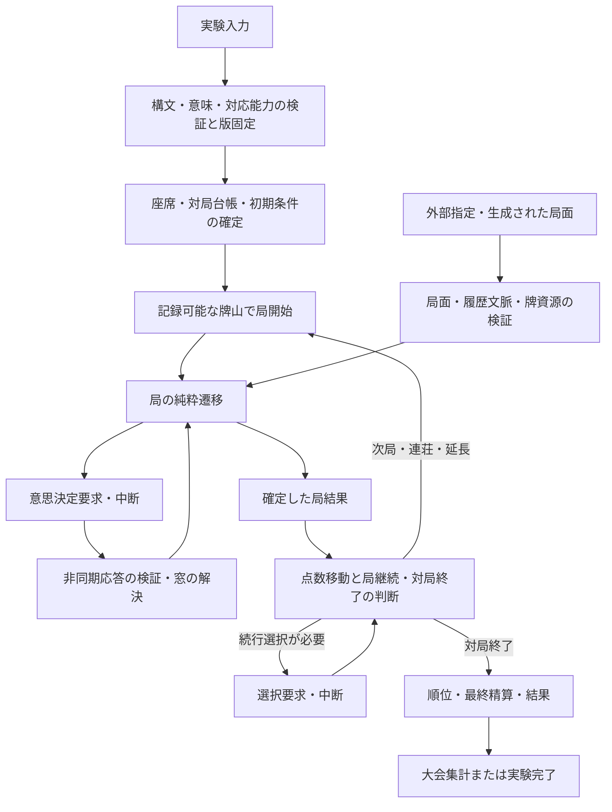

# 再設計案: ゲームの意味論と実行境界

区分と適用範囲は[レビュー案の入口](README.md)に従う。本書の図・状態名・責務は概念モデルであり、Rust trait、struct、enum、公開APIを確定しない。判断待ちIDは[一覧](questions.md)を参照する。

## 1. Project goals and non-goals

### Confirmed requirement

| 目標 | 観察できる契約 | 根拠 |
|---|---|---|
| 決定的・再現可能なsimulation | 同じ完全入力と互換意味版で、同じ局結果・対局結果・canonical event・状態hashになる | 今回の依頼、NFR-001、DATA-001〜005 |
| 高スループット | ルールの正しさを維持し、多数卓の意思決定をまとめて処理でき、性能を計測できる | 今回の依頼、NFR-004、QUEUE-001〜003 |
| 並列実行 | 独立卓を並列に進め、worker数やbatch境界がルール意味論を変えない | 今回の依頼、NFR-002、QUEUE-004 |
| 非同期agent interaction | 要求を発行して中断し、応答を検証して一度だけ再開する | AGENTS.md、CORE-007、AI-002〜006 |
| 複数ruleset | 行為、解決順序、局・対局終端、支払いの差を明示する | 今回の依頼、CORE-001〜005、RULE-001〜008 |
| Replayability | 外部入力・乱数由来の事実・ルール版から進行を再現し、不一致位置を説明できる | DATA-001〜004、008〜009 |
| Mechanicsとrule behaviorの分離 | 牌の移動などの共通操作が、サービス名や暗黙の標準ルールを持たない | 今回の依頼、既存ルール設計 |
| Testability | network/GPUなしで遷移・不変条件・ルール差・再生を検証できる | CORE-008、NFR-007、既存テスト戦略 |
| 外部指定局面からの実行 | 特定局面の期待値評価と、外部生成した学習用局面からの開始を扱う。残り山の設定・生成方針は生成側が持つ | 追加依頼、CORE-009〜010、DATA-010 |

Rust、functional core / imperative shell、状態を消費する型付き継続、外部入力の検証、`xiangting` / `hule`の境界アダプター利用は[AGENTS.md](../../AGENTS.md)の製品方針として維持する。具体的な型分割、継続の表現、アダプターAPIは改めて設計する。四人・三人への対応、卓内・対局・大会・段位の責務分離も維持する。

非目標はGym API・互換層・単一環境を同期的に進める公開`step()`、GUI、オンライン対戦サービス、公式サービス通信・牌譜取得tool、物理的作法や審判運用の完全再現とする。対象外条項は出典台帳で追跡する。RL学習器や新しい点数計算器を今回の設計作業で作ることも含まない。

### Candidate design

中心の評価単位を「一局が正しく完了すること」「対局が正しく精算されること」「多数卓を待機中にも進めること」に分ける。学習データ出力は観測・行為・結果から射影し、特定RL frameworkの時間刻みや報酬APIをゲーム意味論へ持ち込まない。

性能評価は固定入力の遷移数/秒、局数/秒、意思決定数/秒、稼働卓あたりmemory、queue待機・推論・再開latency、replay速度を別々に測る。通常局だけでなく応答競合、長い連荘、複数ruleset混在をworkloadに含める。数値目標はQ-10で決める。

### Unresolved question

大会・段位・チーム・トーナメント、全preset catalogを新しい初期releaseの条件とするかはQ-01。既存COMP系要求やRULE-003〜004を削除する判断はしていない。プリセットの実装優先順位は雀魂段位戦（四人/三人）→天鳳段位戦（四人/三人）→麻雀一番街段位戦（四人/三人）を維持し、龍龍および競技団体・リーグを含む[既存catalog](../design/rules-and-presets.md#7-必須プリセット-catalog)の対象は変更しない。

## 2. Domain model

### Confirmed requirement

局は`Round`、東風・東南等の一対局は`TableMatch`、大会日程の節は`Matchday`と呼ぶ。座席と参加agentは別概念である。牌の非公開情報とagentに見える情報を区別し、外部serviceの表現をdomainへ直接持ち込まない（AI-001、SCORE-003）。

### Candidate design

| 概念・境界 | 所有する意味 | 他の概念との関係 |
|---|---|---|
| 実験 | 解決済みrule版、engine/adapter/model版、実行方針、乱数計画 | 複数の独立した対局または大会を起動する |
| 対局 | 座席割当、得点・供託の台帳、場・局位置・本場、親、終了判断 | 一局の開始条件を渡し、確定した局結果を一度だけ精算する |
| 局 | 牌の所在、手番、宣言・応答窓、和了/流局に必要な資格と履歴 | 検証済みルールと局開始条件を使い、確定した終局理由・事実を返す |
| プレイヤーの局内状態 | 手牌、副露、河、北抜き、立直、フリテン、第一巡・一発等の資格 | 座席で対応付ける。得点の正本をここへ重複保持しない案 |
| 牌資源 | 使用牌multiset、順序、通常取得・補充取得の領域、表示牌 | 取得・移動と公開可否を分ける |
| 意思決定点 | 原因、actor、可視情報、完全な合法手集合、rule版、局の世代 | 外部応答の検証対象として固定する |
| 応答窓 | 共通原因に対する複数座席の選択、必要なslot、解決条件 | 到着順に行為を実行せず、揃った選択を純粋に解決する |
| 局結果 | 終端理由、和了者と評価文脈、聴牌・流し満貫等の確定事実 | 終局後に規則を再評価して局を再開する情報ではない |
| 精算 | 理由付き点数移動、供託、本場、親・局位置、終了/続行判断 | 和了評価、点棒支払い、最終順位点を区別する |
| ルール意味論 | 合法性、優先、遷移順序、終了、支払いを決める決定的な規則 | ルール入力形式、出典registry、runtimeから分離する |

牌は赤牌を区別し、同種牌の個数を扱う。37種count、牌山配列、個別identity不要という旧設計は有力な比較対象だが、メモリ表現と外部schemaはQ-02で再評価する。source固有の物理IDはconformanceのtraceに閉じる候補とする。

河を履歴として残しつつ鳴かれた牌を副露へ移す場合、河の履歴項目を物理的な牌の二重所有と数えない。表示牌も「別に増えた牌」ではなく王牌への参照である。消費済み牌を元配列に残す実装でも、論理的な所在は一つにする。

局内の立直可否には現在得点等が必要なため、対局の台帳を終局まで一切読めない設計にはしない。候補は「対局が正本を所有し、局へ必要な開始値と局中の確定移動を渡す」方式と「一つの純粋な集約が台帳と局を所有する」方式。供託の宣言・成立・取消を二重計上しない境界はQ-06で決める。

### Unresolved question

牌表現（Q-02）、親の初期状態と取得由来（Q-03）、局と台帳の原子的更新（Q-06）。`PlayerSet`のassociated type、固定配列長、既存の型parameterは確定要件ではない。

## 3. Game lifecycle

外部指定局面を受け入れる別の開始経路を設ける。局面生成側が具体化した入力を検証し、対応する局内phaseから通常遷移へ合流する。配牌をもう一度実行したり過去の供託を再徴収したりしない。受入phase、必要な履歴、残り牌資源の受渡しは[外部指定局面案](positions.md)とQ-13で扱う。

### Confirmed requirement

対局の正常終了、局の終了、実験の打切り・失敗を区別する。局が終わっただけで対局を終えず、荒牌平局をそのまま次局仕様と見なさない（MATCH-001〜005、DATA-005）。

### Candidate design

この図の外側に実行状態「実行可能／応答待ち／出力待ち／完了／失敗／取消」を置く。出力backpressureやworker待機は麻雀上のphaseではない。timeout、cancel、管理上の打切りは記録済み外部入力として注入し、勝手に流局へ変換しない。

対局終了の判断は、ルールが指定する点数移動・供託・連荘判定との順序を持つ。最終局、親の順位、目標点、飛び、延長、親の続行選択が競合するため、単一の「残り局数」では表せない。有限な実験予算で止めることと、ルール上の終局条件が成立することも別に記録する。

### Unresolved question

最初のレビュー対象を一局＋対局のどこまでとするか（Q-01）、選択可能な続行と強制終了の優先、管理打切りを適用できる境界（Q-05、Q-09）。実際のrule値は出典確認前に設定しない。

## 4. State transitions

### Confirmed requirement

古い状態を消費し、次状態・型付き中断点・完了を返す。外部の不正入力で部分更新を公開しない。ルール判断は決定的なdomain計算であり、schedulerへ麻雀の優先規則を移さない（CORE-006〜008、QUEUE-004）。

### Candidate design

次のphase名は説明上のラベルである。各phaseに必要な文脈を示し、具体的なRust型の数は決めない。

| 遷移元・保持する文脈 | 入力・条件 | 次の意味状態 | ルールが判断する点 |
|---|---|---|---|
| 局開始前: 牌山・座席・親・開始条件 | 検証済みの局開始 | 初回意思決定または取得待ち | 配牌方式、初期表示、親の第一取得の意味 |
| 外部局面入力: phase・局内状態・対局文脈 | 必要な入力と検証条件を満たす | 指定したphaseの進行状態 | 資格・牌資源・台帳の整合。受入phaseと供給契約はQ-13 |
| 取得待ち: 次のactor・取得元 | 通常取得または補充取得の許可 | 自手番の意思決定 | 取得可能資源、終端条件、取得由来による資格 |
| 自手番: 手牌・取得牌・由来・資格 | 通常打牌または立直を伴う打牌 | 打牌への応答窓 | 食い替え、立直可否、宣言の仮確定範囲 |
| 自手番 | 合法な自摸和了選択 | 確定局結果 | 和了資格、評価に含む表示・状況 |
| 自手番 | 槓または北抜きの宣言 | 宣言への応答窓または成立処理 | 宣言可否、搶槓等の対象、反応が不要な条件 |
| 宣言への応答窓: 宣言前の意味・候補・全slot | 解決済みの応答集合 | 和了終端または宣言成立 | 和了優先、宣言不成立時に何を移動・公開しないか |
| 宣言成立: 補充・表示更新の予定 | 規則に沿った内部処理 | 補充取得待ち等 | 表示時点、補充元、途中流局判定との順序 |
| 打牌への応答窓: 原因牌・打牌者・資格 | 和了/副露/見送りの集合 | 和了終端、副露後打牌、補充待ち、通常取得待ち | 複数和了、頭ハネ、副露優先、見送り効果 |
| 打牌への応答窓 | 全反応の解決後に終端条件成立 | 確定局結果 | 荒牌平局、途中流局、流し満貫、聴牌確定 |
| 副露後の打牌: 呼出牌・構成・禁止打牌 | 合法な打牌 | 打牌への応答窓 | 通常ツモを挟まないこと、食い替え等 |
| 選択可能な途中流局の意思決定 | 合法な終了選択 | 確定局結果 | 採用ルールと選択資格 |
| 確定局結果: 終端事実・未適用の精算情報 | 対局進行規則 | 次局、続行選択待ち、対局終了 | 支払い、連荘、本場、供託、延長、終局優先 |

「候補の検出」「規則で採用するかの判断」「原子的な状態更新」を区別する。たとえば途中流局の形を検出しても、不採用のrulesetなら局の継続状態を保つ。確定終端を返してから外側が取り消す方式は候補にしない。

槓・北抜きの宣言時点で補充牌を消費する案は、反応で宣言が不成立になる場合と衝突する。宣言、応答解決、成立、表示、補充の部分順序をruleごとに明記する案を比較する（Q-05）。すべての種類を一つの順序へ固定したり、種類ごとにengine全体を複製したりしない。

外部応答の検証中は継続を保持し、不正応答では消費しない候補とする。検証済み応答で遷移した後の内部不変条件違反は、protocol retryと区別して実行失敗にする。既存の「消費後errorでは状態回収を要求しない」という低水準APIの方針を、そのままagent応答受付へ適用しない（Q-09）。

### Unresolved question

状態分割の粒度、初回配牌・取得後・副露後の共有範囲（Q-03）、閉じたdataとしての継続の表現とsnapshot境界（Q-08）、宣言成立の順序（Q-05）。

## 5. Action / legal-action model

### Confirmed requirement

合法手はあるdecision pointとrule版に対する有限集合である。agentが返したIDを保存済み集合と照合し、未知・重複・期限切れ・不正actionを区別する。行為の優先順位は応答到着順に依存しない（AI-002〜006、CORE-004）。

### Candidate design

行為は「選択意図」、eventは「解決後に起きた事実」とする。ロンを選べたことと、競合解決の結果その座席の和了が成立したことを分ける。

| Decisionの文脈 | 合法手に含める候補 | 保存すべき意味 |
|---|---|---|
| 自手番 | 打牌、立直付き打牌、自摸和了、暗槓、加槓、北抜き、選択式途中流局 | 対象牌・使用牌の構成・宣言の有無・取得由来 |
| 打牌への反応 | 見送り、ロン、チー、ポン、明槓 | 原因牌、対象座席、副露の構成、赤牌の使用 |
| 宣言への反応 | 見送り、許可された和了 | 原因宣言、和了資格、見送りの効果 |
| 対局続行の選択 | ルールが認める終了・続行 | 精算済みの得点・順位・親と選択権 |

同じ牌種の手切と摸切、立直の有無、赤牌を使う副露構成は意味が異なるため、候補をまとめない。一方、意味のない同種牌の個体番号で候補を増やす必要は再評価する。通常の取得は強制された内部遷移であり、agentが任意に選択するactionと混同しない。

合法手生成と適用は同じ合法性の定義を共有する。各候補を適用できること、集合にない選択を受理しないこと、encode/decodeで意味が変わらないことを契約にする。ルール切替や局再開後に古い集合を再利用しないよう、要求に局の世代・原因・schemaを結び付ける。

応答窓の見送りは状態を変えないとは限らない。和了機会を見送ったことによる資格変化を、他家の副露や和了との競合規則に従って扱う。候補が見送りだけの座席への要求省略も、trajectoryと資格更新が一致すると確認してから行う。

固定action space＋maskと、可変長の合法手リストのどちらでも、domainの選択内容とモデルのIDを分離する。schema版、候補順序、並び替え時のID意味を明示し、hash mapの反復順序をIDにしない。

### Unresolved question

action符号化と観測schema、候補省略時のtrajectory、合法手maskからの情報漏洩（Q-07）。同じ要求への異なる二応答を単に先着採用してよいかはQ-09。arrival順序独立の保証は、同じ要求ごとの確定応答を与える条件で評価する。

## 6. Rule-dependent decision points

### Confirmed requirement

rulesetは数値の袋ではない。構文・値範囲だけでなく、意味の整合とengine/評価adapterの対応能力を検証する（RULE-002、SCORE-004）。卓内・対局・大会・段位は分離し、完全snapshotと不変IDを保存する。公式値を推測しない。

### Candidate design: 7境界の影響マトリクス

LA = legal actions、ST = state transitions、AR = action resolution、HT = hand termination（本書では局終了）、RC = round continuation（連荘・次局）、GT = game termination（対局終了）、SS = score settlement。`—`はその判断点で直接の変更なし、`→`は確定結果を通した下流への影響。以下は設計ケースであり、サービス別の公式値ではない。

| 規則差の領域 | LA | ST | AR | HT | RC | GT | SS |
|---|---|---|---|---|---|---|---|
| 使用牌・人数・赤牌 | 牌候補、対象座席 | 配牌・取得・座席巡回 | 有効座席 | 枯渇資源 | 親の巡回 | 規定の局構成 | 人数・赤牌評価 |
| 親の14枚配牌/13枚＋取得 | 第一打の手切/摸切 | 初期phase・取得由来 | — | →第一巡資格 | — | — | →状況役 |
| チー可否・食い替え | 呼出と直後打牌 | 呼出後打牌 | 副露競合 | →第一巡終了 | — | — | →役・責任払い |
| 立直資格・成立時点 | 宣言、以後の選択制限 | 宣言中/成立、供託時点 | 宣言牌への応答 | →四家立直等 | →本場・供託 | →得点条件 | 供託、成立資格 |
| フリテン・見送り | ロン可否 | 資格の付与・解除 | 見送り効果と採用結果 | →和了可否 | — | — | →和了者 |
| 暗槓・加槓・明槓 | 立直後制約・資源条件 | 宣言/成立/補充/表示 | 搶槓と成立の優先 | 四槓等 | →流局種別 | →精算結果 | 槓ドラ・責任払い |
| 北抜き | 抜き可否 | 補充元・第一巡等の資格 | 宣言への和了可否 | →枯渇・和了 | →局結果 | →精算結果 | 抜きドラ・支払 |
| 頭ハネ/複数ロン/三家和 | 応答候補との整合 | 解決後の分岐 | 勝者集合・優先 | 和了/流局の選択 | 親の結果 | →得点・終了 | 本場・供託の配分 |
| 途中流局 | 選択式なら終了候補 | 自動検出時点 | 和了等との優先 | 採用/不採用 | 連荘・本場 | 延長/終了との関係 | 点棒・供託の扱い |
| 荒牌平局・聴牌・流し満貫 | 公開等を選ぶなら要求 | 終局時の確定手順 | 複数資格の扱い | 分類と確定事実 | 親聴牌等 | 聴牌止め等 | 罰符・流し満貫 |
| 役・和了条件・ドラ | 和了可否 | 公開資格・時点 | 和了候補の有効性 | 和了成立 | →親和了 | →得点条件 | 符・翻・上限 |
| 支払・三麻補正・責任払い | — | 確定支払い | 複数和了配分 | — | →親/結果条件 | 飛び・目標点 | payer、額、丸め |
| 連荘・本場・局進行 | — | 次局の開始条件 | — | — | 親・場・局位置 | 規定局/延長 | 本場・供託繰越 |
| アガリ止め・聴牌止め・飛び | 続行選択があれば候補 | 選択待ち/終了 | 終了条件間の優先 | — | 続行の可否 | 強制/任意終了 | →残供託・順位 |
| 同点順位・返し点・順位点 | — | 最終結果の確定 | — | — | 追加局規則があれば影響 | 同点終了/追加局 | 順位・端数・残供託 |

### Candidate design: 規則を評価する契約

| 判断点 | 必要な入力 | 決定的な出力 | 共通mechanicsとの境界 |
|---|---|---|---|
| 合法性 | phase、actorの状態、局文脈、rule版、評価能力 | 完全な合法手と必要パラメータ | mechanicsは候補を勝手に追加しない |
| 競合解決 | 原因、各座席の確定選択、優先規則 | 採用行為・見送り効果・局終了または続行 | 到着時刻を使わず、一度だけ適用 |
| 宣言成立 | 宣言、反応結果、資源、資格 | 成立/不成立、移動・公開・補充の順序 | mechanicsは指定された移動の整合を検証 |
| 局終了 | 局内の確定事実、採用規則 | 終端理由、和了・聴牌等の確定結果 | 局終了後に外側が採否を再判定しない |
| 局継続 | 局結果、精算後台帳、対局位置 | 親、本場、供託、次局仕様 | 牌山生成・時刻取得をしない |
| 対局終了 | 得点・順位、規定局・延長、親、選択 | 終了、続行、意思決定要求 | 管理cancelとは別の意味を持つ |
| 精算 | 評価結果、支払方針、供託、本場、責任 | 理由付き移動と台帳更新 | 二重評価・二重支払いを防ぐ |

規則表現は「閉じた判断の種類＋検証済みデータ」と「決定的なpolicy実装の合成」を比較する。前者は網羅性・版管理が明快で、新しい遷移にはengine変更が要る。後者は差異を隔離しやすいが、任意callbackを許すと副作用・互換性・順序の保証が難しい。動的pluginや汎用rule言語の採用は決めない（Q-04）。

組合せ検証には、北抜きと補充資源、槓上限と表示資源、複数和了と流局優先、立直供託と開始点・終局支払い、人数と座席・支払・順位の整合を含める。同じflagが別のphaseで別の意味を持つことを避ける。規則の記録には値だけでなく、判断の意味版と必要capabilityを含める案とする。

### Unresolved question

規則表現（Q-04）、競合と宣言の順序（Q-05）、卓内支払いと対局精算の責務（Q-06）、評価adapterの実際の対応範囲（Q-12）。

## 7. Invariants

### Confirmed requirement

不正状態は可能な限り型で表現不能とし、外部入力は検証する。決定性、牌と点数の整合、情報可視性、継続の一回性を保つ。具体的な型で保証できない範囲は境界検証・遷移検証で補う。

### Candidate design: 不変条件と検証点

| ID | 不変条件 | 保証する境界・将来の検証 |
|---|---|---|
| INV-01 | 使用牌multisetが保存され、各牌の論理的な所在は一つ | 初期牌山検証、全移動後のproperty。鳴かれた河と表示牌参照を二重加算しない |
| INV-02 | 手牌・副露・槓・北抜き・取得牌の枚数がphaseと整合 | phase別契約。取得後を無条件に「14枚」としない |
| INV-03 | actor、親、応答座席が有効で、配牌順と固定座席の対応が一意 | 開始条件検証、座席回転に対する性質 |
| INV-04 | 通常取得・補充・表示が利用可能な領域と上限を守る | 枯渇前後、補充直後、表示参照の非破壊性 |
| INV-05 | 合法手生成と適用が一致し、schema変換で意味が失われない | 各合法候補の適用、非法候補拒否、encode/decode |
| INV-06 | 宣言・牌移動・資格更新・点数移動が原子的である | 不正応答・競合・不成立宣言で部分更新しない |
| INV-07 | 得点＋供託＋明示source/sinkの収支が一致する | 立直成立/不成立、複数和了、終了時精算。順位点と点棒台帳を混ぜない |
| INV-08 | 局終端と精算が一度だけ確定し、同じ結果を二度適用しない | 重複完了・再送・snapshot再開のmodel test |
| INV-09 | 要求は一つの局世代・意思決定点に属し、継続は高々一回再開 | duplicate、unknown、late、cancelの順列 |
| INV-10 | 同じ確定応答集合なら到着順・worker数が結果を変えない | 応答順列、batch分割、drive budget変更 |
| INV-11 | 観測はその座席の情報履歴と公開ruleだけから決まる | 他家の秘匿情報のみを変えて観測と合法手maskを比較。公開推論可能情報は区別 |
| INV-12 | 同じ意味状態のcanonical表現が安定し、ログ欠落・破損を検出 | replay、sequence、hash、schema不一致テスト |
| INV-13 | 局中のrule意味版は固定される | preset alias変更・registry更新が実行済み局へ影響しない |
| INV-14 | 外部指定局面も進行に必要な不変条件を満たし、欠落文脈を暗黙補完しない | phase・牌保存・資格・台帳の入力検証。到達性保証とは区別する |
| INV-15 | 同じ基点からの試行は互いの状態・継続・乱数入力を汚染しない | 固定牌資源での再現、試行順・worker数変更、通常進行との将来結果一致 |

例示テスト、property、状態機械テスト、評価adapterの契約テスト、元牌譜とのconformanceを組み合わせる。既存テストを新設計へ機械移植せず、「何を守る契約か」を抽出し、内部indexやAPI形状のassertionとは分ける。今はテスト実装・Currentの選択を行わない。

### Unresolved question

snapshotで保証する不変条件と再検証費用（Q-08）、合法性判定が利用できる情報の境界（Q-07）、数値表現とoverflow方針（Q-06）。

## 8. Randomness and determinism model

外部指定局面では、残り山を固定するか・ランダム化するか、その分布・生成方法は局面生成側が決める。simulatorは実際に供給された牌資源を検証・記録する。局面の固定部分と試行ごとの差分、牌資源を開始時に渡すか遅延供給するかの候補は[外部指定局面案](positions.md)を参照する。

### Confirmed requirement

coreは乱数・時刻・I/Oを自分で取得しない。同じrule、牌山、AI応答等の外部入力と互換コード版から同じ結果を得る。モデルの再推論が同じ結果になる保証とは分ける（NFR-001〜002、DATA-001〜002）。

### Candidate design

| 層 | 同一性の条件 | 保証の対象 |
|---|---|---|
| 局・対局の再実行 | 初期条件、rule意味版、牌山、要求ごとの確定選択、管理入力、互換engine/adapter | canonicalなドメインevent、結果、状態hash |
| 実験の再実行 | 上記に加えて座席割当、大会入力、再試行・失敗方針、モデル束縛 | 論理的な卓ごとの結果と決定的な集計 |
| 再推論 | モデル、入力、sampling、backend数値演算の契約が必要 | 条件を満たす場合だけ同じ選択。無条件のGPU bitwise一致は約束しない |

乱数用途を牌山、座席・対戦割当、agent samplingなどで分離し、安定した論理IDからstreamを割り当てる案を置く。worker番号、起動時刻、queueからの取得順をseedの決定要因にしない。連荘でも同じ場・局番号を再利用して同じ牌山を作らないよう、局の実行通番を区別する。再試行と新しい試合は異なる意味にする。

保存方式は「確定した全牌山」と「版付き生成方式＋seed/stream/counter等の再構成情報」の比較とする。後者はRNG名だけでは不十分で、初期牌順、shuffle手順、乱数消費、整数sampling方法まで固定する必要がある。前者は容量が増えるが生成器の将来変更から再生を独立させやすい。

timeoutを実時間から判定した場合、worker数によって発生するtimeout自体は変わり得る。同じseedだけで実時間込みの同一runを保証しない。再生では記録済みのtimeout/cancel・代替選択を同じ論理境界へ注入する。

卓間のevent到着順は運用ログとして保持できるが、麻雀上の意味順序ではない。卓ごとのsequenceと因果参照で比較し、実験全体のhashが必要なら卓ID等の安定順序による集約を検討する。大会の動的割当が完了順に依存する場合は、その割当を入力として記録するか、決定的なbarrierを設ける必要がある。

### Unresolved question

RNG方式・stream導出・牌山保存方式・実験全体の再現保証（Q-08）、timeoutを含む実行方針（Q-09）。具体的algorithm、hash、serializationは未選定。

## 9. Replay / event model

外部指定局面からの実行では、その局面を開始根拠として保存し、開始以後を再生する（DATA-010）。配牌から到達したとする架空のevent prefixを作らない。基点・試行の識別、履歴要約と検証保証、具体化した牌資源を記録する候補を[外部指定局面案](positions.md)に示す。

### Confirmed requirement

公開event・schemaは版を持ち、完全情報とagent向け射影を分離する。入力・イベントから終端状態を再構築して照合できること、不完全runを成功扱いしないことが必要である（DATA-001〜009）。

### Candidate design

| 記録 | 内容 | 用途 |
|---|---|---|
| 実行manifest | 解決済みrule ID/hash、コード・依存・model版、schema、初期条件、乱数・失敗方針 | 意味と入力の固定 |
| 再実行入力 | 牌山、要求に対応した選択、管理入力、必要なら評価adapterの記録済み結果 | 互換engineで遷移を再計算 |
| Canonical domain event | 配牌・取得・行為採用・宣言成立・応答解決・終局・精算の確定事実 | 計算結果の照合と状態再構築 |
| Protocol監査 | 全外部応答、重複、不正、期限切れ、retry、backend失敗 | 受付経緯。到着順を保持してもdomain hashへ混ぜない |
| Snapshot | 検証済み状態と継続、rule版、stream位置、対応hash | 高速な再開の候補。唯一の再生根拠にしない |
| 観測・trajectory | 座席別の可視情報、合法手、選択、結果、打切り・代替選択の印 | 学習・評価向けの独立した射影 |

再生モードを区別する。

1. **入力による再実行**: 記録した入力から合法性・解決・遷移を再計算し、eventとhashを照合する。rule実装のregression検出に使う。
2. **事実による再構築**: 確定eventを適用して状態を復元する。必要な差分がeventに十分含まれることを検証する。これだけでは当時の合法性が正しいとは証明しない。
3. **外部牌譜conformance**: sourceを逐次decode・projectし、同じ意味のcheckpointで比較する。source固有eventとcanonical eventの一対一対応は要求しない。

たとえば14枚配牌sourceを初回取得へ正規化する案では、sourceの一eventから複数canonical事実が生じ得る。projectorのtraceを残し、適当にevent数を合わせない。完全な`majsoul-record`はuserが外部で取得・管理し、conformance appで1パス比較する方針を維持する。CIには手書き最小fixtureだけを置き、中間`game_log`を必須にしない（ADR-0011）。

最小限のevent文脈候補は、schema意味版、streamとsequence、対局・局世代、原因decision/window、rule版、確定した意味差分である。時刻・thread・batch IDは診断metadataに分ける。応答窓のcanonical記録は座席等の安定順に並べ、到着順の監査記録と分ける。

保存障害時は「応答を受け付けた」「継続を消費した」「eventを保存した」の食い違いが生じる。論理的な一回適用と、永続化・ackの原子性は別問題としてQ-08で設計する。途中までのevent列は検証可能なprefixとして扱い、完了markerがないrunを成功にしない。不一致reportには最初のstream位置、原因入力、期待/実際の事実・hash、版、source locatorを含める候補とする。

### Unresolved question

event粒度、snapshot・永続化・ack順序、互換再生とmigrationの保証範囲（Q-08）、報酬とtrajectoryの射影（Q-07）。既存のRust memory layoutをwire形式にしない。

## 10. Candidate crate boundaries

### Confirmed requirement

実装と独立したCI・repository metadata・ライセンス等は可能な限り維持する。domainへ非同期runtime、乱数源、storage、GPU、外部評価crate固有型を持ち込まない。現在のfacade/core/rules構成を継承する前提はない。

### Candidate design

まず責務を分け、crateへ分割する数は後で決める。下表はcrate名や作成計画ではない。同一crate内moduleに留める選択も含む。

| 候補境界 | 含める責務 | 含めない責務 | 分割を判断する材料 |
|---|---|---|---|
| ゲーム意味論 | 値、不変条件、合法手、純粋遷移、解決、局結果、精算 | queue、serde形式、サービス固有decoder | 局・対局・rules間の変更頻度と依存循環 |
| ルール入力・registry | 構文、出典、意味/capability検証、完全snapshot | 進行中の牌を直接操作すること | 入力依存をdomainから隔離できるか |
| 観測・外部protocol | 観測射影、action符号化、request/response schema | 麻雀上の優先順位 | モデルとの互換性を独立に管理できるか |
| 実行shell・broker | 卓の所有、queue、batch、backpressure、失敗の注入 | 途中流局採否、支払規則 | runtime・backend依存と計測結果 |
| Replay・記録 | manifest、canonicalization、store、再生照合、migration | service固有のルール補正 | schema更新とstorage交換の頻度 |
| 評価adapters | `xiangting` / `hule`との変換・capability | 独自の暗黙ルールや二重支払い | 外部API・ライセンス・公開状況 |
| Conformance app | local source decode/project、逐次比較、trace/diff | 牌譜取得・coreのservice依存 | 既存ADR-0011の運用を維持 |
| 大会・段位 | 割当、順位、集計、次stage | 局内の牌・行為の直接変更 | 初期release範囲（Q-01） |
| 利用者入口・composition | 実験の組立、必要ならfacade | 隠れたglobal state・ルール分岐 | 公開APIと配布単位（Q-11） |
| 外部局面の入力境界 | 局面のdecode・検証、通常進行への変換 | 局面分布・残り山の生成方針・期待値の集計 | 通常domainと共通の不変条件、外部生成器との契約（Q-13）。独立crate化は未決 |

依存方向の比較案:

| 案 | 構成 | 利点 | 懸念 |
|---|---|---|---|
| A | 一つの純粋domain内にmechanicsとrule判断のmoduleを置き、入力adapterがdomainへ依存 | rule判断と状態の循環を避けやすく、初期のcrate数が少ない | 公開面・module規約の維持が必要 |
| B | ルール意味契約を独立させ、game mechanicsがそれを利用。入力registryも契約へ依存 | 入力・出典を切り離しつつ意味版を共有 | 過去と同じ型所有問題、細分化の費用 |
| C | 少量の共有意味値を独立させ、mechanicsと規則評価を分離し、純粋な進行層で合成 | 依存方向と契約を明示しやすい | 共通crateの肥大化、分割だけが目的になる危険 |

どの案もrulesの決定を非同期schedulerへ移さず、adapterは内側の契約に依存する。現行の`core -> rules`はBに近い調査例であり、選定理由にはしない。静的dispatch・動的dispatch、generic・enum、固定長・可変長は正しさと計測を踏まえQ-11で判断する。

### Unresolved question

crate境界・公開入口・依存方向（Q-11）、規則評価の表現（Q-04）、外部評価capability（Q-12）。今回Cargo manifest・lockfile・Rust sourceは変更しない。
